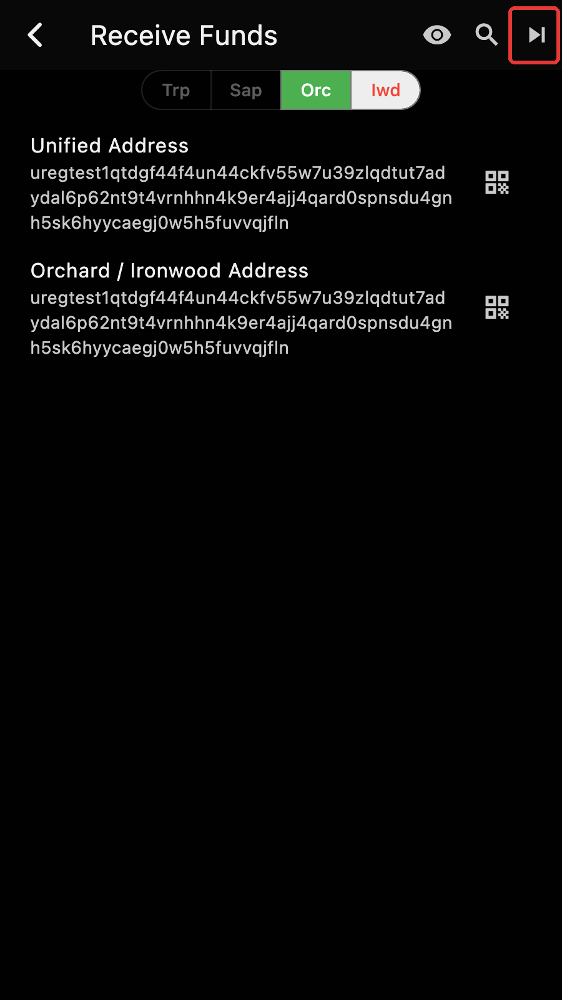
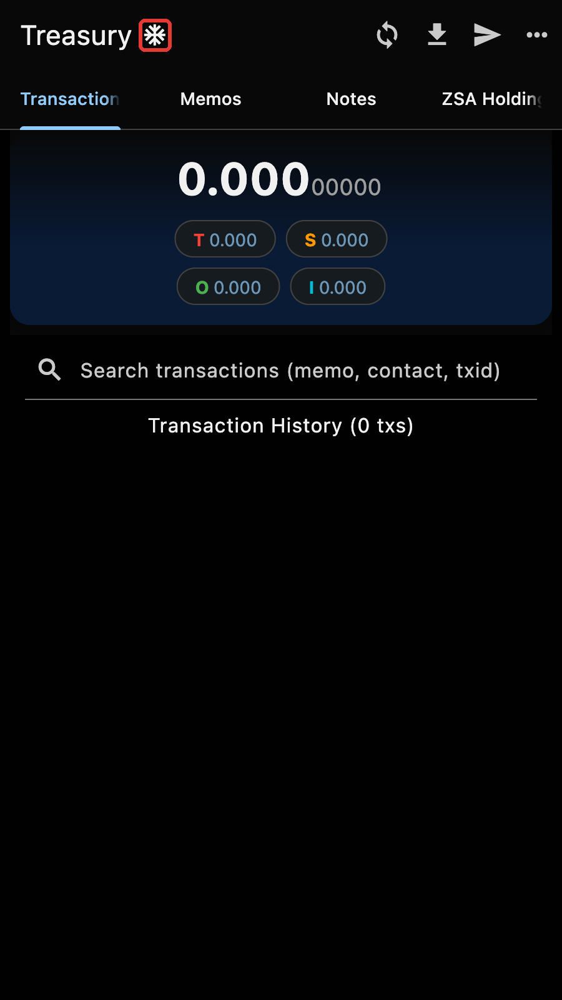
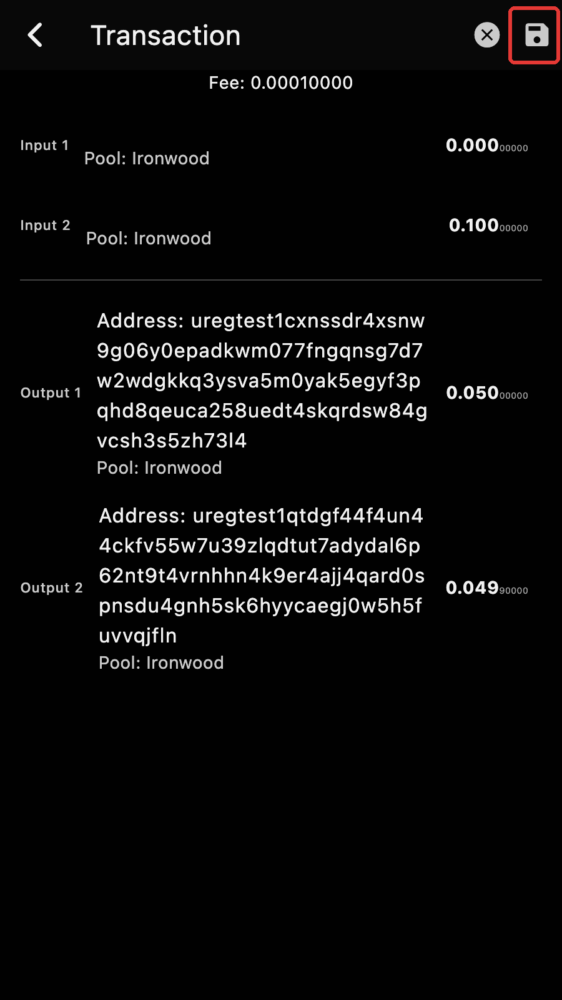
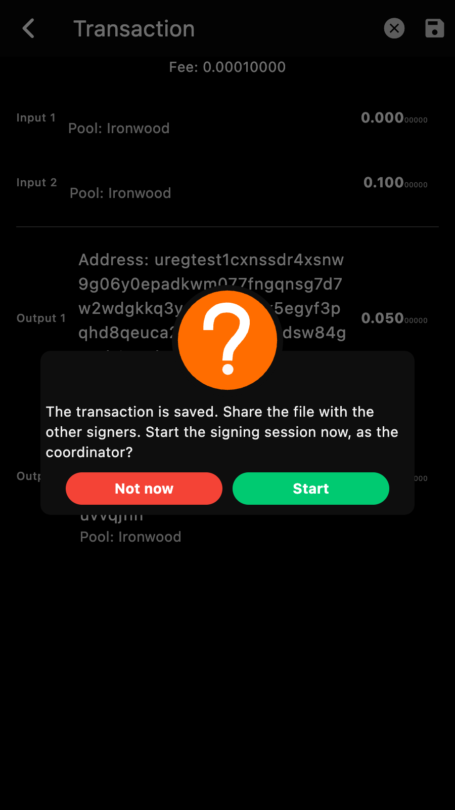
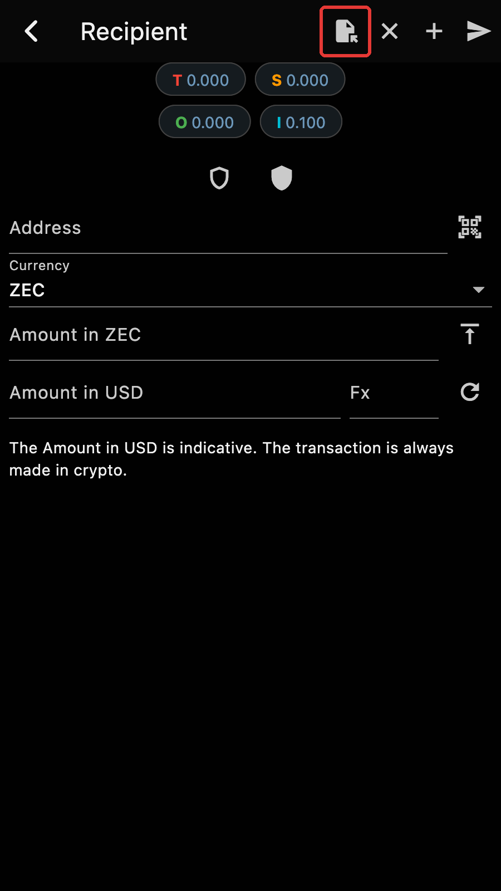
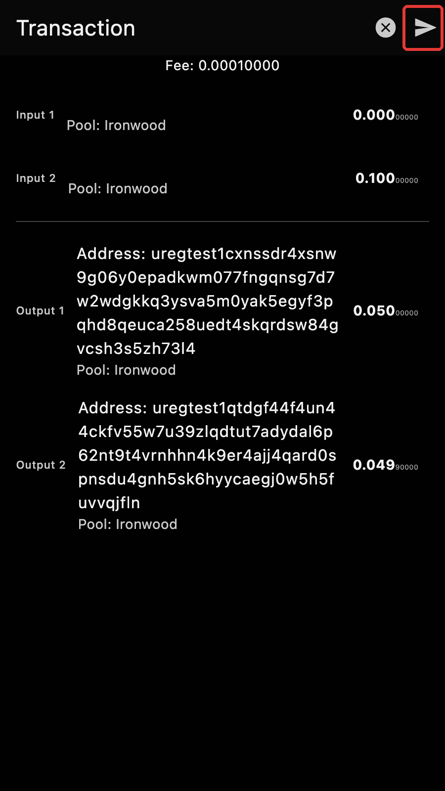
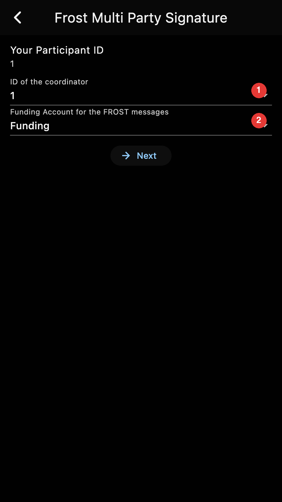
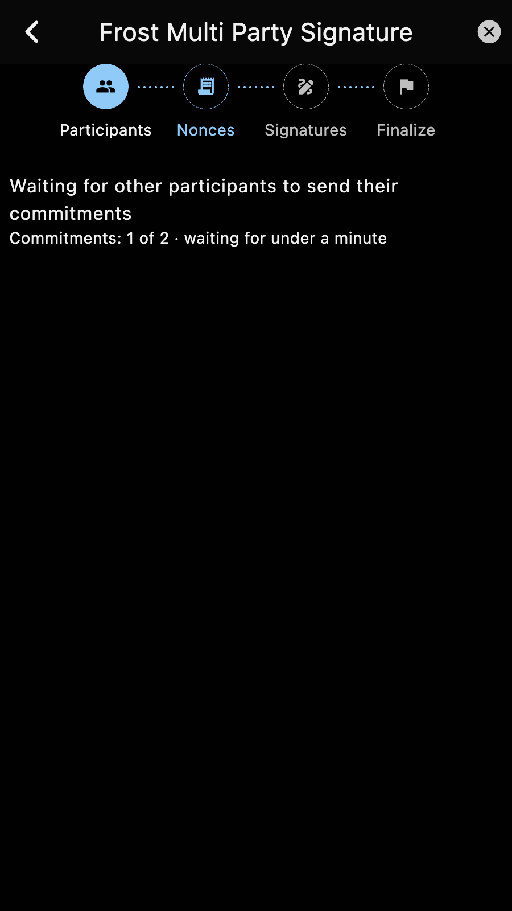
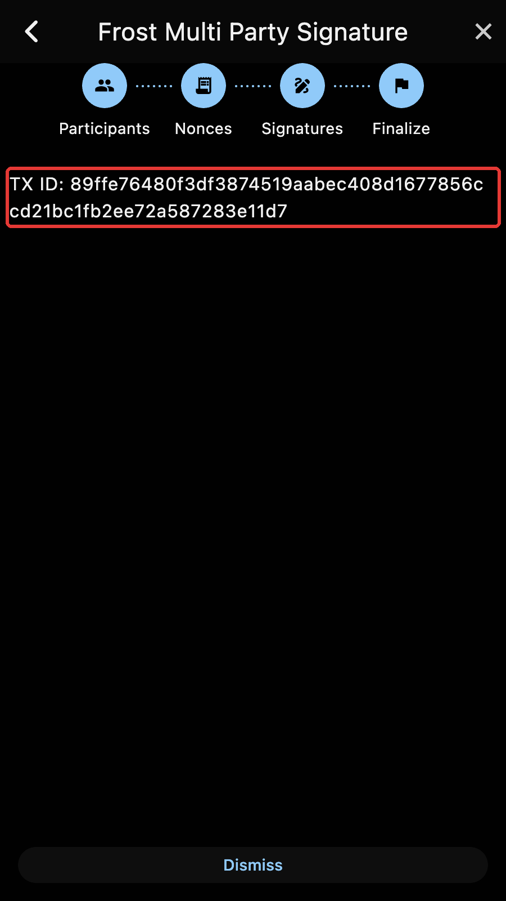
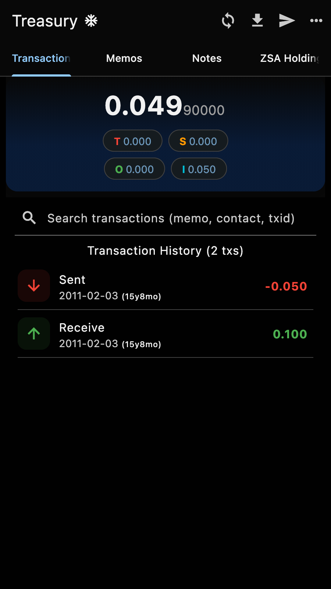

## Receiving Funds

The MultiSig Account works like a standard account for receiving funds.
The address is on the "Receive Funds" page. You can get more addresses[^1] by
tapping on the "next" button.

## Requirements

Like with DKG, you need to have a funding account to pay for the transaction
fees of the FROST SIGN protocol. You should to have ~0.01 ZEC in it.

The snowflake icon next to the account name marks the MultiSig Account.

## Roles

Spending from the MultiSig Account takes a number of participants equal to
the signature threshold defined at the creation of the account: the M in "M
out of N". In our example, we need two signers out of Alice, Bob and Charlie.

Every signing session has two roles:

- The **coordinator** proposes the transaction, sends the unsigned
  transaction file to the other signers, collects their signature shares,
  assembles the transaction and broadcasts it. The coordinator is one of the
  signers: their own share counts.
- The other **signers** receive the file, check it, and sign it. They do not
  need to talk to each other, only to the coordinator through the chain.

The participants must agree on who coordinates before they start: every
signer enters the coordinator's ID in the signing form, and the session
cannot complete if they do not match.

Since this is a 2 out 3 MultiSig Account, Alice coordinates and needs one
other signer, say Bob. Charlie does nothing.

## Coordinator: Starting a payment

Spending from the MultiSig Account begins like a standard payment, with the
specification of the recipients with addresses and memos.
A multisig transaction can be exactly like a standard transaction: It is usually
input manually or by copy pasting, but it can also have multiple recipients, use
a payment URI, or be loaded from a file.

Since the MultiSig Account has no spending key, the transaction page cannot
send the transaction. Its button saves the *unsigned* transaction to a file
instead.

Save the transaction by tapping on the save button and choosing an output file.
Send this file to the other signers.
It can be done out of band, by email, by USB, by posting on the shared drive,
etc. The transaction file has the details of the transaction but does not
contain any signature.

::: warning
The file holds no key, so nobody can spend with it. But it reveals the amount,
the recipient, the memo and the group's viewing key. Send it only to the
other signers, over a private channel.
:::

Once the file is saved, Zkool offers to start the signing session as the
coordinator.

- "Start" opens the [signing form](#signing-form) with your ID as the
  coordinator.
- "Not now" lets you start later: load the file back like the other signers
  do, then pick your own ID as the coordinator.

## Signer: Loading the transaction

The other signers should open the transaction file:
- Start a transaction from the MultiSig Account,
- Tap on the "Load an unsigned transaction" button and pick the transaction file.

::: important
Every participant should **CHECK** the transaction before signing it.
:::

You sign the transaction you load, and your signature (share) cannot be
tampered. You are safe as long as you make sure to **CHECK** the transaction.

Then tap on the "Sign with the group and send" button to open the signing
form.

## Signing Form

Both roles go through the same form.

1. Enter the ID of the coordinator. Every participant **must** enter the same
   coordinator ID. For the coordinator, it is their own ID.
2. Select the *funding account*.

Tap the NEXT button to start the MPC SIGN.

## The session

The steps at the top of the page show where the signing is, and the status
line says what Zkool is doing or waiting for, with how many participants
have answered.

### Coordinator

The coordinator announces its address, then waits for the commitments of the
other signers. When the threshold is reached, it broadcasts the signing
package, collects the signature shares, adds its own share to form the
complete signature, builds the full transaction and broadcasts it to the
network.

Once it finishes, a popup announces that the transaction was sent, and the page
shows the transaction ID.

### Signer

The signer waits for the coordinator's announcement, sends its commitments,
waits for the signing package, and sends its signature share.

> The session completes on a signer with the message "Signing completed".
> They can close the page. The coordinator sends the signed transaction once
> all the signature shares are received.

## Finishing up

Once the transaction is mined, it will appear in the account transaction
history of every participant[^2].

::: tip
As with DKG, the SIGN is automatic as long as Zkool is opened on the multisig
page. If you close it, the "Send" button of the MultiSig Account brings you
back to the session in progress.
:::

::: warning
A group transaction expires about a day after it was prepared. If the
participants have not finished signing by then, the page says so: prepare a
new transaction and sign it again.
:::

[^1]: Diversified addresses.
[^2]: A MultiSig Transaction is undistinguishable from a standard transaction
    unlike MultiSig in Bitcoin.
