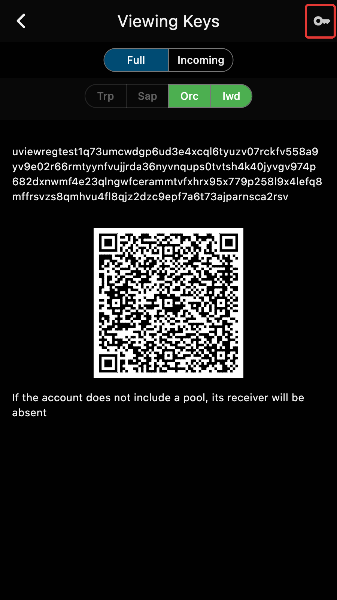
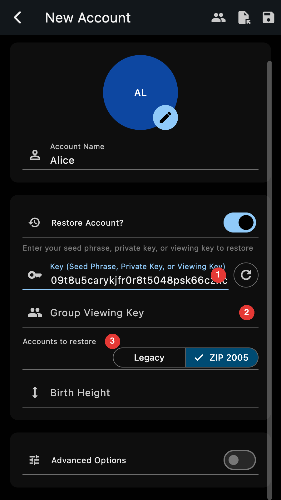

Zkool supports multisignature accounts that leverage the **FROST** technology.

Multisignature accounts differ from standard accounts in several ways.

::: warning
I highly recommend you read this section since MultiSignature
accounts may not behave as you expect.
:::

- MultiSignature Accounts (MSig Acct) are created via a distributed
Key Generation process described in the [Distributed Key Generation (DKG)](./dkg.md) section.
- A MSig Acct involves a several entities/individuals who create the shared
  address of the account.
- During DKG, the number of signers needed for a payment is set.
- For example: a "2 out of 3" MSig Acct requires 2 participants out of the 3
  account creators to [sign a transaction](./mpc.md). One of them, the
  *coordinator*, proposes the transaction and broadcasts it once the others,
  the *signers*, have signed it.
- The MSig Accts do not have a known secret key[^1]. They have a unified viewing key
  and of course an address.
- Funds sent to the MSig Acct address ends up in the account, just like for a
  standard account. From an external point of view, a MSig Acct is
  undistinguishable for a standard account[^2].
- MSig Accts are Ironwood (ZIP 2005) accounts. They do not have a transparent,
  sapling or orchard receiver, and their funds are quantum recoverable.
- MSig Accts have diversified addresses. New addresses can be generated by any
  participant without coordinating with the others.
- MSig Accts do not have a seed phrase. They do not have a complete secret key. They have
  a *share* of the secret key.
- In the account page, a snowflake icon next to the name marks a MSig Acct.

## Backup

A MSig Acct has no seed phrase. Instead, every participant has a **backup
string** that starts with `zkfrost`. It holds your share of the secret key:
treat it like a seed phrase.

Open the "Backup" option of the account page menu, then tap on the key icon
("Show Backup String").

The page shows the backup string, its QR code, and the **group viewing key**.
Save both: to restore your membership on another device, you need the backup
string *and* the group viewing key. The viewing key is the same for every
participant, so you can also get it from any other member.

To restore, create a new account, turn on "Restore Account?" and paste the
backup string in the key field (1). The form then asks for the group viewing
key (2) and which account to restore (3): "ZIP 2005" for a group created with
the current version of Zkool.

You can also export the account like any other account, or save the whole
database file.

::: important
Save your backup string and the group viewing key. Without them, a lost
device means a lost share, and the group may no longer reach its threshold.
:::

## Legacy Groups

Groups created before ZIP 2005 have an Orchard address and are not quantum
recoverable. Their account page shows a banner with an "Upgrade" button. The
upgrade creates the group's ZIP 2005 account, with a new address, and sweeps
the funds into it. The sweep is a group transaction: it has to be
[signed](./mpc.md) by the threshold of participants, like any payment.

All the participants of a group must run the same version of Zkool. The DKG
stops with an error when they do not.

## DKG and Signing Multi Party Ceremonies

The Distributed Key Generation and the Multi Party Signing are multi step
workflows that involve the transmission of secure messages between the
participants.

Zkool uses the Zcash blockchain and leverages encrypted memos to send and
receives the commitments, signature packages, signature shares, etc.

### Funding

The communication necessitates a bit of ZEC to pay for the transaction fees.

They should be in a separate account from the MultiSig Account. This is called
the **funding account**.

::: tip
0.25 ZEC should be more than enough for ~100 multisig transactions.
:::

If the funding account does not have enough, the DKG or SIGN page shows the
balance of the funding account against the cost of the next message, and
retries at every block. Add funds to the funding account and the operation
resumes by itself.

### Sequentiality

::: important
A given database can only process *one DKG* and *one SIGN* at a time.
If you need to make more than one, you need to use another database file.
:::

[^1]: There is a secret key but it is split between the participants and unknown
    by any single participant.
[^2]: Unlike for Bitcoin where the multisig account have a different prefix than
    standard p2wkh.
