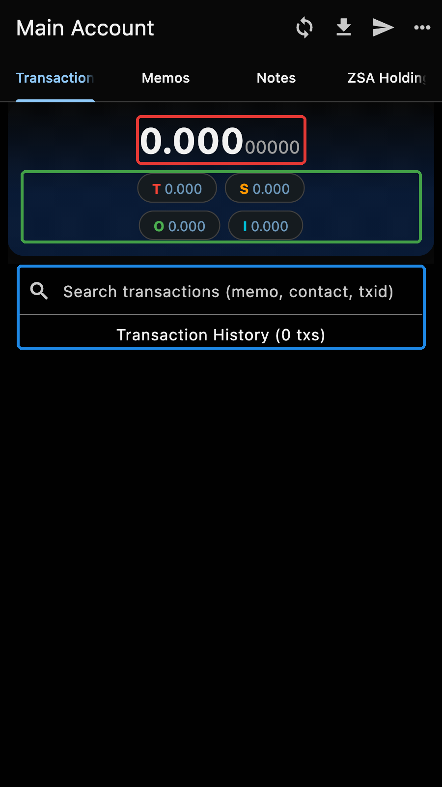
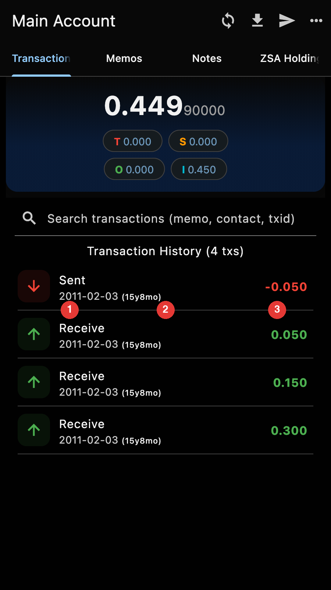

The account page has four tabs:
- Transactions
- Memos
- Notes
- ZSA Holdings

The appbar has the sync, receive and send buttons.
The menu (three dots) has the rest: Account Manager,
Settings, Edit Account, Backup, Market Price,
Fetch Tx Prices, Export, View as List/Table,
Charts and Voting.

## Transactions

The main tab is the transaction tab. It shows
the summary of the account, and the transaction history.

### Balances

In the red box, you have the total balance of the account
and its value in your currency.

Below, in the green box, you have the balance
of each pool. Tap on it to collapse or expand the pool balances.

If the mempool has transactions for this account,
the unconfirmed amount is shown under the balance.

::: warning
All funds are made available immediately. Zkool
does not have a note maturity requirement.
:::

But if you want to exclude some notes from spending,
you can do so in the note tab.

### Synchronization Progress

During synchronization, a progress bar appears above
the balance. It shows the current account height
and how many blocks it is behind the tip of the blockchain
(i.e. the latest block), as "tip-XYZ".

::: note
If you haven't refreshed the current block height[^1], Zkool will not show "tip-XYZ" because it does not know the current height.
:::

### Transaction History
In the blue box, you have the transaction history.
This account has no transactions but for illustration
purposes, here's a screenshot of another account that has some.

Each transaction row has
1. The type and the contact name (if the address is in your [contacts](../recipe/contacts.md))
2. The date and how long ago it was
3. The amount (in Green when funds are incoming)

The type can be one of:
- Receive: Incoming funds
- Sent: Outgoing funds
- Shield: An internal transfer from the transparent pool to a shielded pool
- Unshield: The reverse of the previous type
- Self Transfer: A fully shielded internal transfer
- T. Self Transfer: A transparent internal transfer
- Migration: A transfer of notes from Orchard to Ironwood

::: tip
The search box filters the history by memo, contact name or
transaction id.
:::

The history is a list by default. The menu option "View: Table"
switches it to a table with more columns (category, memo, asset).

Tap on a transaction to see its details.

### Memos

The memo tab shows the memos included in the transaction
outputs. If the memo is in binary, it is shown as a
hex string.

::: tip
You can search *text* memos using the search bar.
:::

Tap on a memo to go to its transaction page.
Long press on it to edit the memo text. The edit is only
stored in your wallet: the memo on the blockchain cannot change.

### Notes

The notes tab shows the current unspent output notes.

::: tip
Tap on a note to lock or unlock it. Locked notes are
excluded from spending.
:::

The appbar of this tab has shortcuts to lock the recently
mined notes, toggle every note, unlock every note,
show or hide the dust notes, and group the notes by pool.

The account balance does not change even if notes
are locked[^2]. The send page warns you that
"Some notes are disabled".

### ZSA Holdings

The last tab lists the Zcash Shielded Assets (ZSA) of the account,
if any.

[^1]: By tapping on the height on the account manager,
or automatically with auto-sync.
[^2]: If you lock some notes and choose
the spend MAX option, the transaction will not have
enough funds.
