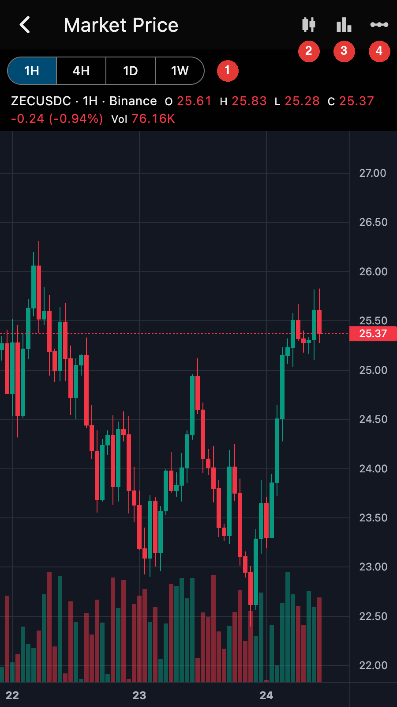

## Market Chart

The market chart shows the ZEC price. It is an embedded
TradingView chart and needs an internet connection.

Open it from the "Market Price" option of the account page menu.

## Reports

[See Categories / Reports](../report/overview.md)

## Cold Wallet

[See Cold Wallet](../recipe/cold.md)

## Frost

[See MultiSig Account](../frost/overview.md)

## MultiPay

[See Payment URI](../recipe/puri.md)

## TOR

[See TOR](../recipe/tor.md)

## Mempool Viewer

[See Mempool](../recipe/mempool.md)

## Voting

[See Coin Weighted Voting](../vote/howto.md)
