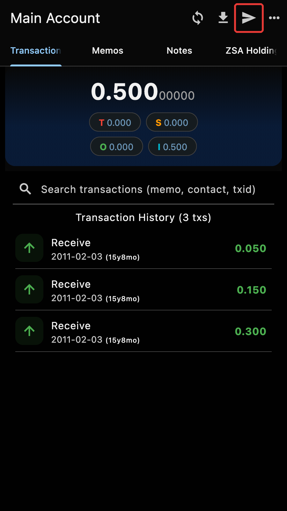
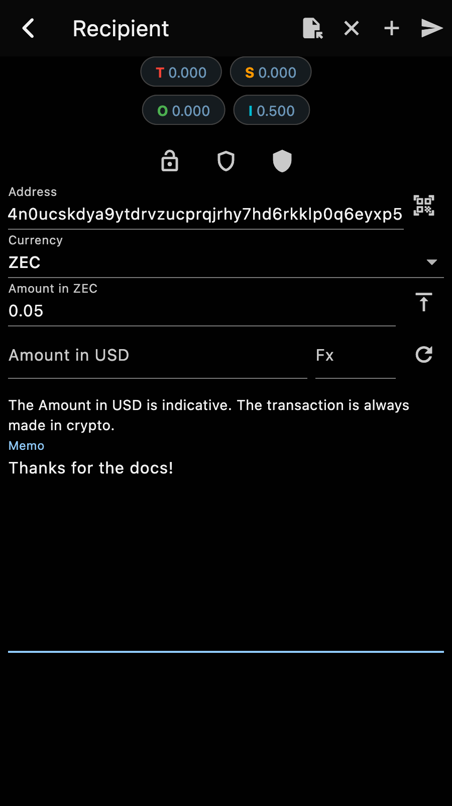
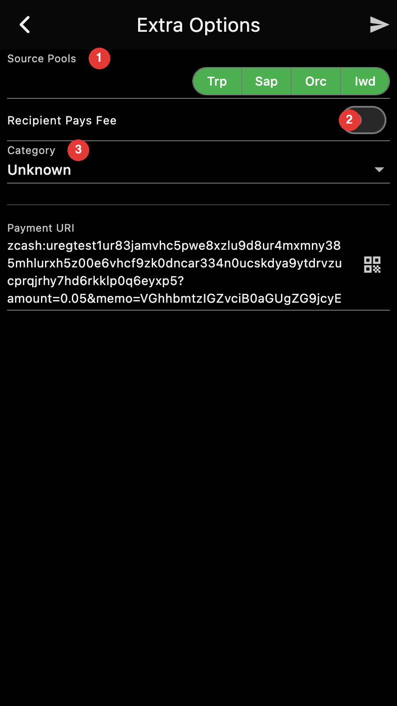
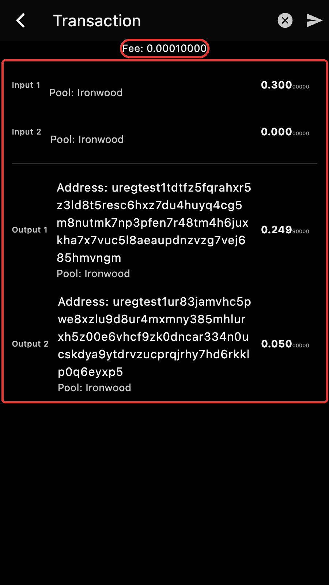
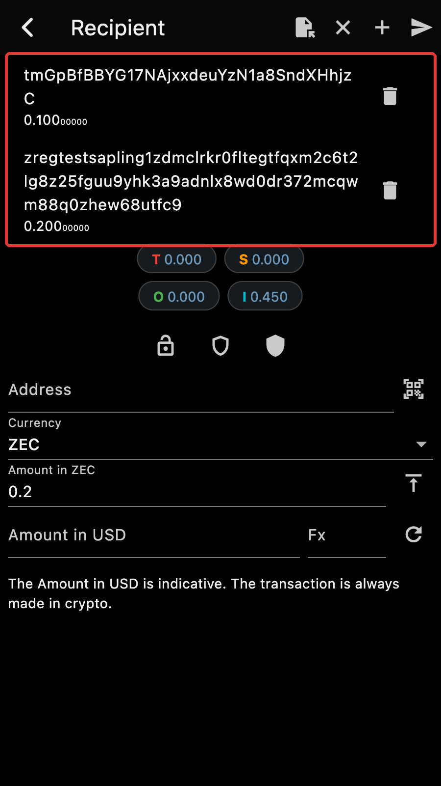

## Basic payments

- Select the account to send from,
- Click on the send button (in the red box),

- Enter the destination address and the amount
- If the destination is shielded, you can attach a memo

::: warning
Transparent addresses do not accept memos.
The memo field disappears when the address is transparent.
:::

The page also has:
- your pool balances at the top. Tapping on a pool fills in
your own address for that pool: this is how you transfer funds
between your pools,
- the "Unshield All", "Shield One" and "Shield All" shortcuts,
- a QR code scanner button next to the address,
- the "Currency" selector, for sending ZEC or a Zcash Shielded Asset you hold,
- the "MAX" button, and the amount in your currency next to the amount in ZEC.

::: tip
In the address field, type `!` to pick one of your own accounts,
or `@` to pick a [contact](../recipe/contacts.md).
:::

Click on the send button to continue to the next step.

If the account is behind the current height, Zkool offers
to synchronize it first.

::: tip In most of the cases, you can leave everything as it is.
:::

Here's what the form means.

1. Choose which pools you allow Zkool to use. Zkool will try to maximize your
privacy by choosing notes that give the most private transaction. But it is not
always possible. For example, if you have Transparent funds, Zkool can use
them if there isn't enough Sapling or Orchard funds. By deselecting a pool,
you tell Zkool not to use it.

> This is unlike most shielded wallets that **NEVER** use transparent
funds of your wallet to send to an external address.

2. By default, you pay for the transaction fees and you
spend more than the amount you indicated on the previous page.
If you switch this on, you tell Zkool to deduct the fees from the amount
sent to the recipient. Fees are automatically calculated based on the network
rules.
3. Optionally, assign a spending category to the transaction.
See [Categories](../report/overview.md).

The page also shows the **payment URI** of this transaction.

## Payment URI

The Payment URI allows you to "save" the transaction if you need
to repeat it. You can copy/paste a payment URI in the address
field of the Send Page or scan the QR code.

See [Payment URI](../recipe/puri.md)

Click on the "Send" button to continue.

Zkool calculates a transaction and proposes it to you.

You can ignore the transaction plan unless you want
to troubleshoot an issue or see exactly what's going to
be published.

The page shows the fees (related to the number of inputs
and outputs), and the inputs and outputs with their pool
and amount.

## Coin Control

You can exclude some notes from the transaction by locking them in the Notes
tab.

## Confirmation

At this point, you can "cancel" the whole transaction or send it
out.

If you send it, you get a final confirmation prompt and off the
transaction goes. The page shows the transaction id once
the network has accepted it.

Close the page by clicking on the "Dismiss" button.

## Troubleshooting

If you get an error after trying to send the transaction,
it is usually coming back from the server. Unfortunately
server error messages are not famous for their user friendliness.

The most common cases are:
- transport error: Some network issue prevented the submission
of the transaction to the server. You can retry by clicking on
the send button again.
- the transaction uses some input that was already spent. That
is usually because your account is not synchronized to the latest
block and hasn't seen a transaction that has spent the note.

## Multi Recipient Payments

To create a payment with multiple recipients, instead of tapping on the "SEND"
button, choose the "+".

This adds the recipient to a list.

::: tip
Tap on an entry to load it back into the form and edit it.
Remove an entry with its delete button.
:::

The list has the address and amount sent to each recipient, but excludes the
memo field.

When you are done, tap on the "SEND" button. The last recipient
in the form is included too.
