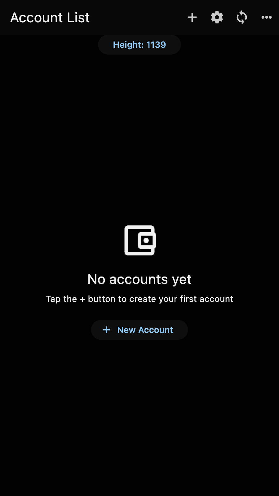

This page covers the basic functionalities
of Zkool.

::: tip
I highly recommend to read this section once
because Zkool does not always work like other wallets.
:::

I am using the MacOS version but the app behaves
similarly on other platforms.

# Installation

Zkool is available on the Google Play Store and the Apple Store.
The easiest way to find it is to search by its name `zkool`.

The app store versions may be behind the "latest and greatest".
The latest version is on the Github release page.

[Releases](https://github.com/hhanh00/zkool2/releases)

The release page has builds for Windows (installer and zip),
MacOS, Linux (Flatpak, AppImage and Deb package), Android (APK)
and iOS.

# First Run

## Disclaimer

Next, you must accept the disclaimer that states
that Zkool is a non custodian wallet.

::: important
You have full control of your secret keys.
**Make sure to have a backup of the seed phrase**
:::

Your keys are only stored on the device database.
If you lose your device, or reset the data, your keys
and your funds are lost if you do not have your seed
phrase.

It may sound obvious, but make a backup of your
seed phrase **before** you send funds to the account.

Scroll to the bottom of the page, check the "I Agree"
switch and click on the "Continue" button.

## Device Authentication

Zkool does not ask for your device authentication when
it starts. It asks for it when you do something
sensitive:

- show or hide the hidden accounts,
- show the seed phrase or the backup string of an account,
- unlock the app when the "Pin Lock" option is on.

The device authentication is the method you use to protect your
device, i.e. a pin, password, fingerprint or face lock.

On Windows, a password is *not* sufficient. You need
to set a PIN, a fingerprint or face lock.

::: tip
"Pin Lock" is off by default. When it is on and you come back
to Zkool after it spent more than 30 seconds in the background,
it shows a locked screen. Tap on the logo to authenticate and unlock it.
The option is in the Settings page.
:::

## Tooltips

Most buttons and fields have a tooltip that explains
what they do. Hover over them with the mouse on desktop,
or long press on mobile.

You should see the account manager screen now.
It is empty.

