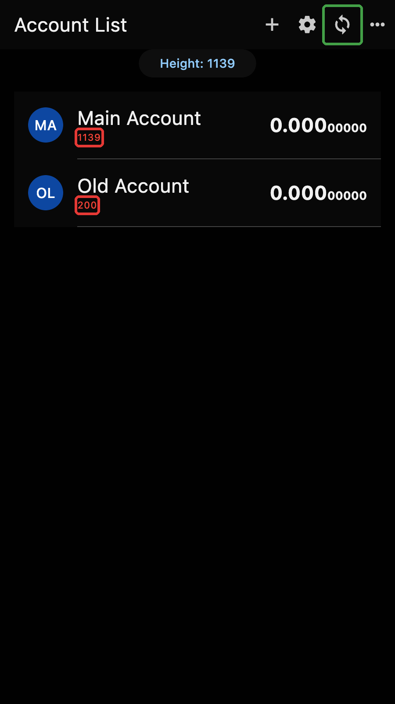

Once all your accounts are entered,
it's time to synchronize.

## Account List

At the top of the list, the "Height" button shows the
current block height. Tap on it to refresh the height
and the market price. Long press to refresh the height only.
Next to it, the market price button shows the current ZEC price
in your currency. Tap on it to refresh the price.

Each row shows the account avatar, name, balance, its
value in your currency, and the account sync height.

Tap on the avatar to select an account. Tap anywhere else
on the row to open the account page.

## Account Heights

Zkool keeps the synchronization state
of each account independent.

This is like your gmail accounts. If you have more
than one, the gmail app
downloads the messages of your current account.
Your other accounts are sometimes behind[^1].

In the screenshot above, you can see the various account
sync heights in the red boxes. The first account was just created
and is at the current height. I restored the second one
with a birth height of 200 and it has not been synchronized yet,
therefore it is still at 200.

## Auto/Manual Sync

If auto sync is on[^2], Zkool will occasionally check
the current block height and compare it with the account heights.
When an account falls behind by some threshold[^3], Zkool
starts synchronizing it.

If you want to start synchronization immediately, tap the sync
button on the appbar (in the green box).
This starts the synchronization of every *enabled* account at once.

If some accounts are selected, the sync button synchronizes
the selected accounts only.

You can also synchronize a single account from its page
with the sync button on its appbar.

## Menu

The menu button (three dots) on the appbar opens the
Mempool, Folders, Categories and [Contacts](../recipe/contacts.md) pages.
It also has the "Show All" option that reveals the
hidden accounts after you authenticate.

[^1]: gmail may scan from time to time in the background.
[^2]: It's on by default.
[^3]: 30 blocks by default. The "AutoSync Interval" in the Settings
changes the threshold. Set it to 0 to turn auto sync off.
