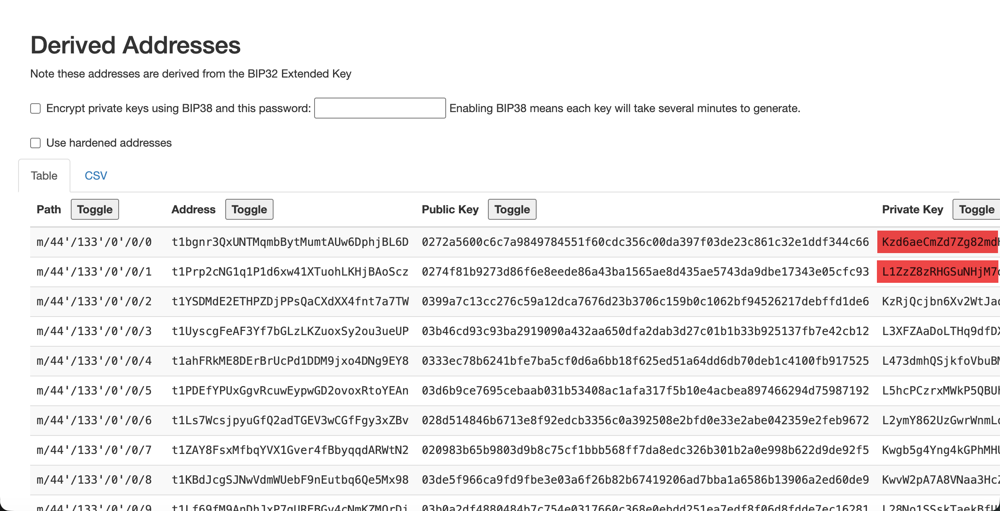

One feature: uncompressed transparent private keys.

*Released 7 May 2026.*

## Uncompressed private keys

Zkool accepts transparent private keys in the uncompressed WIF format, the ones that start with `5`, next to the compressed keys that start with `K` or `L`. The address they derive differs, and the wallet tracks and spends from it. See [Supported Key Types](../recipe/restore.md).

