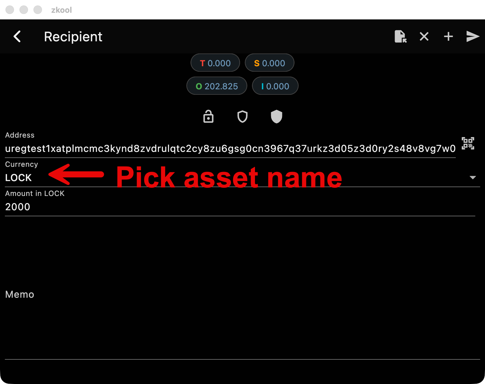

Zcash Shielded Assets, the first time round.

*Released 2 June 2026 as 6.16.0, last patch 6.16.6 on 6 June 2026.*

## Shielded assets

On the ZSA testnet, Zkool shows the assets an account holds, issues new assets, and sends them: the send page has a currency selector with ZEC and the assets you hold. The history and the transaction details show the asset and its amount, with the amount of the asset as the main figure of an asset-only transfer and the asset's name where it is known. Asset names can be edited in place. See [Using ZSA with Zkool](../zsa/using-zsa.md).

The patch releases fixed the ZEC balance and the note selection, which had counted asset notes as ZEC, and the fee of an issuance.

## Removed

The coin voting feature of 6.11 is removed. Voting came back in 6.27 on a new design.

## GraphQL

- The server warns when it runs without JWT authentication, and subscriptions are authenticated too.
- Command line arguments override the configuration file, and the mempool can be turned on again from the command line.
- An example MCP server in `example/zkool-mcp` lets an AI assistant drive the wallet through the GraphQL API.

## Also

- Multisig signing signs the split spends it had left unsigned.
- The app follows the NU7 upgrade on the testnet and picks the matching Orchard proving key.
