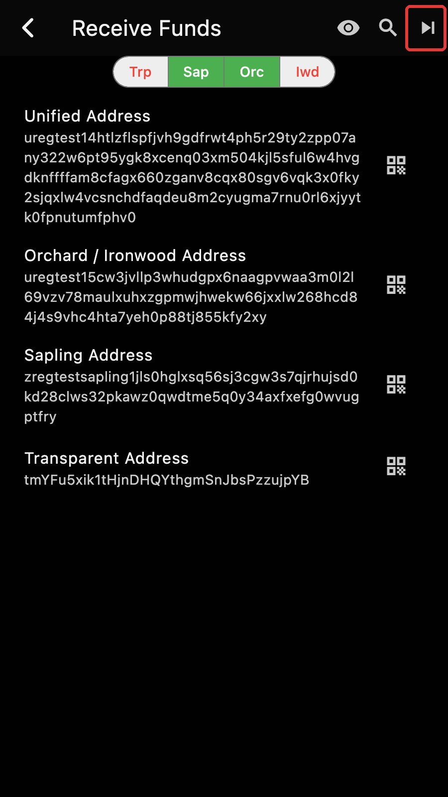

The account page becomes the home page, the addresses page is rebuilt, and prices can be in any currency.

*Released 10 June 2026 as 6.18.0, last patch 6.18.11 on 12 June 2026.*

## The account page is home

Zkool opens on the account page of the account you used last. The Account Manager, which used to be the first page, is reached from the overflow menu. The New Account page is reorganized, with the derivation and pool settings behind an Advanced Options switch, and a wallet with no account yet shows a short help text. The in-app showcase is replaced by plain tooltips. See the [Account](../guide/account.md) guide.

## Addresses

The addresses page derives the addresses of the account index by index and shows, for each one, whether it has been used and how many transactions it has. Filters narrow it to the used or unused addresses, to the external or change addresses, and to the pools you pick; the unified address is built from the selected pools and disabled when only one pool is selected. Tap an address to copy it. See the [Addresses](../guide/addresses.md) guide.

## Any currency

Prices and amounts in fiat can be in any currency CoinGecko quotes, not only USD. Changing the currency converts the stored historical prices, after asking you to confirm the exchange rate between the two. See the [ZEC Price](../report/price.md) page.

## Also

- A Market Price entry in the account page menu opens the price chart.
- The eleven patch releases fixed the Windows build and the release tooling.
