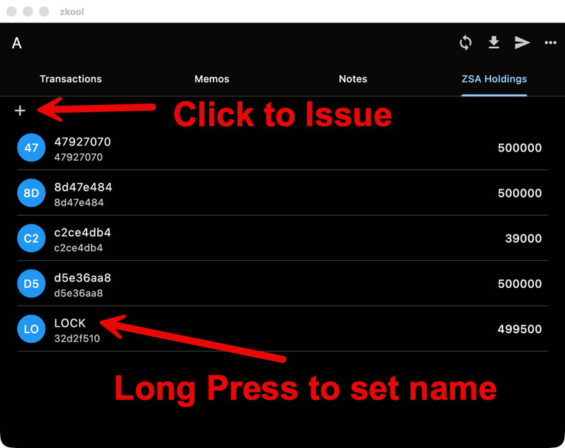

Zcash Shielded Assets are back.

*Released 27 July 2026, last patch 6.25.1 on 28 July 2026.*

## Shielded assets

Support for Zcash Shielded Assets (ZSA) returns, on top of the Ironwood work of 6.24. Notes and outputs are tracked per asset, change is computed per asset with a ZEC change output as ZIP 226 requires, and memos of asset notes are decrypted. Assets can be issued, their amounts are shown in the asset's own units, and asset notes below the ZEC dust threshold are kept. A database whose file name contains `zsa` opens on the ZSA chain. See [Using ZSA with Zkool](../zsa/using-zsa.md).

## Also

- Notes are always selected for privacy, with the fee as the tie breaker.
- The account page no longer flashes a loading state when it reloads.
- 6.25.1 restores the Ledger build and moves to the production versions of the Zcash libraries.
