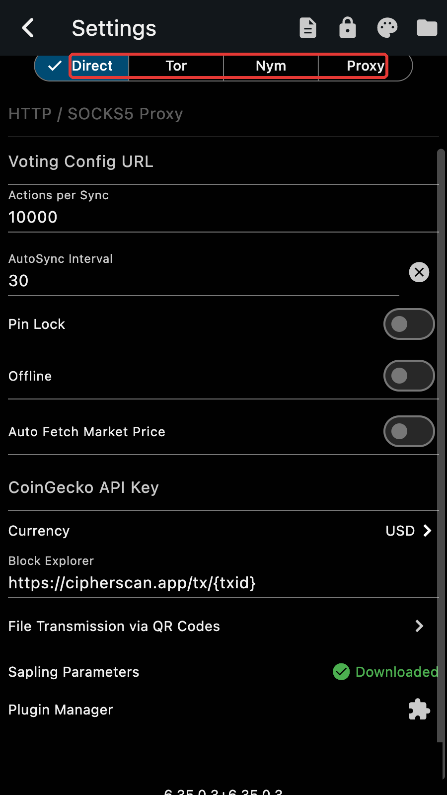

A new anonymity network, the groundwork of coin weighted voting and TEX addresses.

*Released 15 August 2026.*

## The Nym mixnet

The Tor switch in Settings becomes a transport selector with four choices: Direct, Tor, Nym and Proxy. An existing Tor setting carries over.

With Nym, the connection to the server goes through the mixnet and the server name is resolved over the mixnet too, never by your local resolver. A server can also be a native Nym service, with a `nym://` address: the server list offers one ("Zcash over Nym mixnet") and you can paste your own. Zkool then talks to it end to end through the mixnet, with no exit gateway and no clearnet hop. See [Using TOR](../recipe/tor.md), which covers Nym as well.

## Voting groundwork

The wallet core gains coin weighted voting as described in ZIP 262: the voting hotkey, the gathering of the Ironwood notes and their witnesses at the snapshot, the delegation keys and signatures, and the proving and submission of votes. The pages that use it arrived in 6.28.

## Also

- Sending to a TEX address (ZIP 320, `tex1...`) works, and the funds come from the transparent pool whatever the pool selector says.
- The GraphQL server honours `RUST_LOG`.
- The iOS build is fixed.
