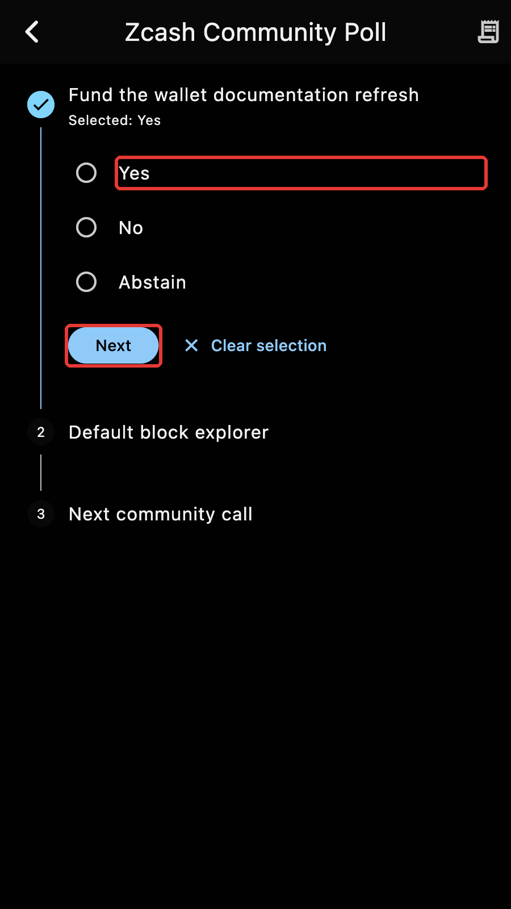

This release rebuilds coin weighted voting on a new foundation and separates the synchronization data of each account.

*Released 27 September 2026.*

## Voting, rebuilt

The voting pages were rewritten around a sidecar database that lives next to the wallet and keeps the state of every round. Selecting Voting opens the list of open rounds, with their details and proposals, while a stepper shows how far the loading has got. The ballot takes one proposal at a time and reopens at the last answered proposal if you leave it halfway. A report lists the decisions recorded for a round.

Before a vote is cast, the eligible notes are previewed. Submitting then walks through delegation, the vote and the delivery of the helper shares, with the progress on screen. If the app is closed before the shares are confirmed, opening the round again resumes their delivery. Requests to the helper servers go through Tor when Tor is the selected transport, and wallet actions that would disturb a run in progress are blocked while it runs.

See the [Voting](../vote/overview.md) section. The submission was carried further in 6.35.

## Per-account synchronization headers

The block headers that anchor the synchronization used to be shared by all the accounts in a wallet. Rewinding or rescanning one account could corrupt another account's anchor. Every account now owns its headers, and the first open after the update migrates the existing ones.

## Also

- HTTP requests to a list of servers try them in a random round robin instead of always starting with the first.
- Tor now carries plain HTTP requests as well, with the Arti client the wallet already uses.
