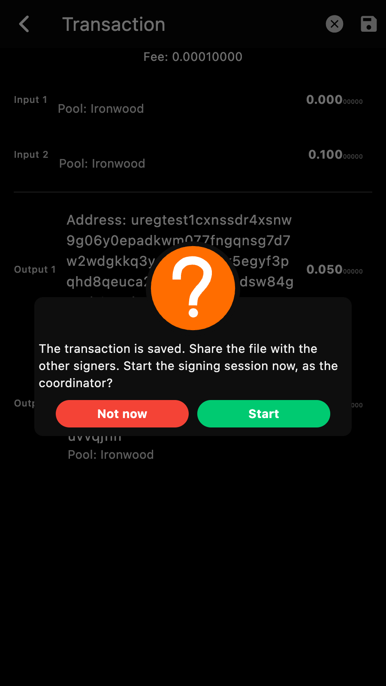
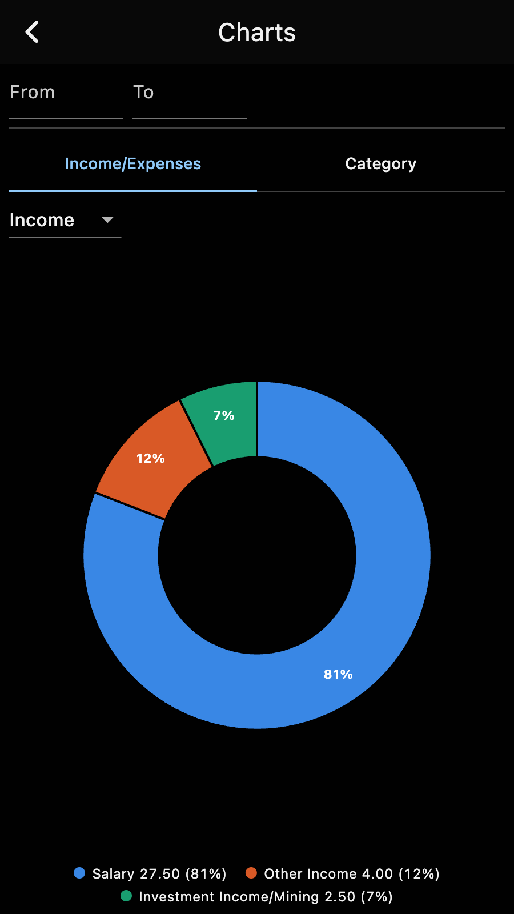
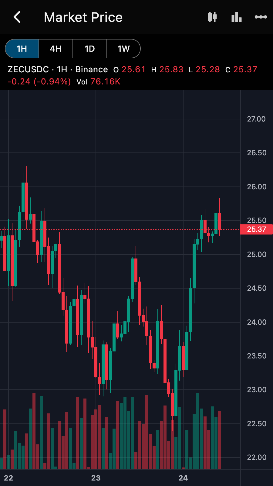
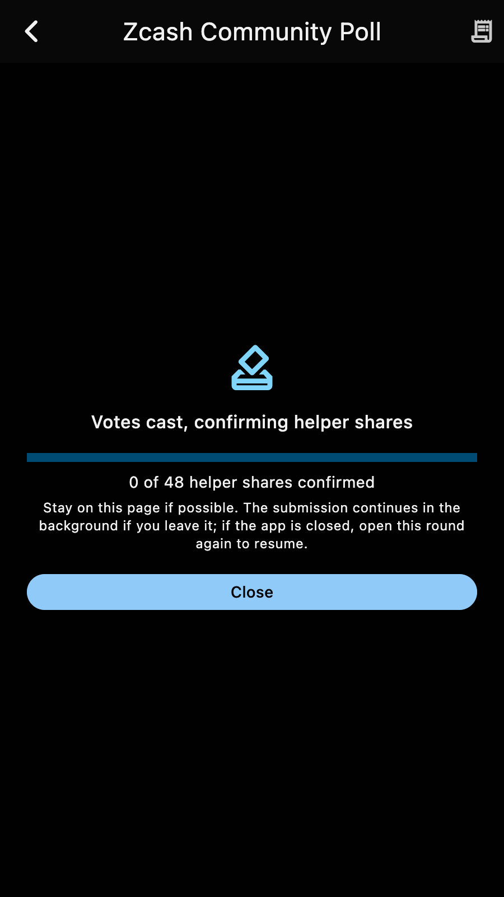
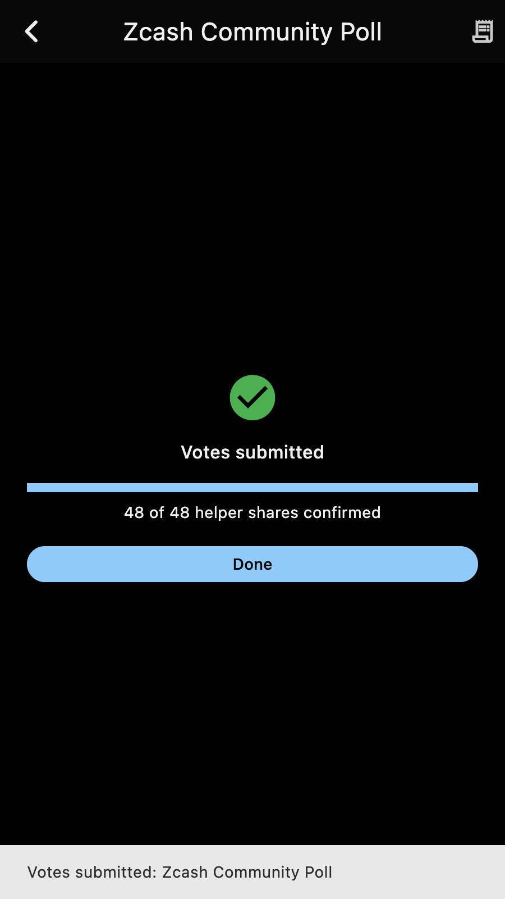
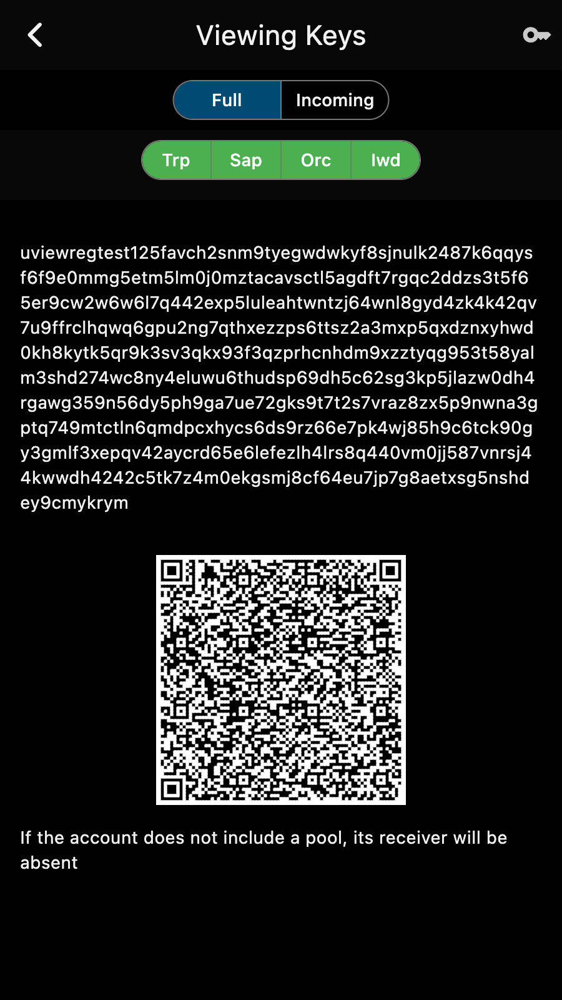

The 6.35 release candidates since the 6.34.0 release carry a lot of new work.
Here is the short version.

*Released 25 October 2026.*

## Ready for NU7

Zkool is built on the stable NU7 mainnet releases of the Zcash libraries. NU7 activates on mainnet at block 3,543,405, and the wallet keeps syncing and spending through the upgrade: it handles the v6 transaction format and the 120-block expiry that NU7 brings, and the Ironwood pool, the successor of Orchard, is where multisig accounts and voting funds already live.

## Multisig accounts on ZIP 2005

FROST group accounts now live in the Ironwood pool, so their funds are quantum recoverable. A group created with an earlier version is upgraded in place, and every member gets a backup string to export and restore. Signing no longer needs the other members' addresses once the key is generated.

Saving a group transaction offers to start the signing session right away, as the coordinator, and the Send button of a group account routes through the running session. The DKG and signing pages now say how far a wait has got and for how long, warn before the transaction expires, keep the cause of a failed pass, and pop up the shared key and the transaction id when they are ready. See the [MultiSig Accounts](../frost/overview.md) section.

## Charts without a webview

The budget charts (income and expenses by category, and a category over time) and the market chart are drawn by the app itself, so they work on every platform, Linux included. The market chart shows ZEC/USDC candles with 1H, 4H, 1D and 1W intervals. See the [Charts](../report/chart.md) page.

## Voting carried to the finish

A coin weighted vote is now taken all the way: once the votes are cast, Zkool confirms each helper share and shows how many are in. The submission continues in the background if you leave the page, resumes by itself when you open the round again, and ends with "Votes submitted" and a notification. See [How to vote](../vote/howto.md).

## Incoming viewing keys

An account can export its incoming viewing key, and a key imported this way becomes an incoming-only account: it shows what it received, with memos and the mempool, and cannot spend. See [Supported Key Types](../recipe/restore.md).

## Also

- Desktop builds open the platform's own file dialogs.
- Contacts import and export vCards.
- A new recipient no longer inherits the previous memo or address.
- Error dialogs show the full cause, with the details one tap away.
- An autosync interval of 0 turns autosync off at once.
- Transparent inputs are priced by size, as ZIP 317 says.
- Changing the database password goes through a copy beside the database, so a failure leaves the original untouched.
