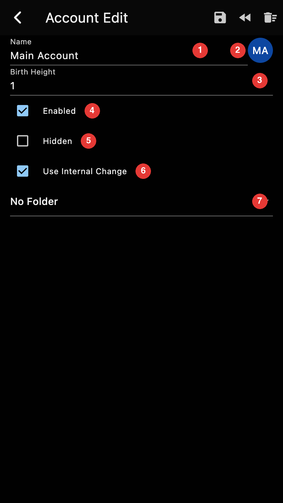

Select one or several accounts to edit by tapping on their avatar.

The "+" button of the app bar is replaced by the Edit and Delete buttons.

::: tip
You can also open the edit page of the current account from the
account page menu, with "Edit Account".
:::

## Edit

You can change

1. the account name,
2. the avatar,
3. the birth height,
4. whether the account is enabled,
5. whether it is hidden,
6. whether it uses an internal address for the change,
7. its folder.

::: important
Changing the birth height or the internal change setting
clears the synchronization data of the account and resets it
to its birth height. You will need to synchronize it again.
Your funds are not lost.
:::

Disabling an account removes it from automatic synchronization
and from the "sync all" button of the account manager.
It can be re-enabled at a later time.

Hiding an account removes it from the main list. Hidden
accounts are visible when "Show All" is selected in the
menu of the account manager (it requires authentication).

Accounts can be organized into [folders](./folder.md). The main list shows
only accounts belonging to the currently selected folder.

If you selected several accounts, the edit page shows the values
they have in common and the change applies to all of them.

If you leave the page with unsaved changes, Zkool asks whether
to save them.

The buttons on the app bar are for:
- exporting the account (and all its synchronization data)
to an encrypted file,
- rewinding the synchronization state back a few blocks,
- clearing all its synchronization state and resetting
the account to its birth height,
- saving your changes.

## Show Keys

The "Backup" option of the account page menu opens
the Viewing Keys page.

It displays the Unified Viewing Key of the account and its QR code.
The pool selector toggles the receivers of the key, and
the "Full" / "Incoming" selector chooses between the full viewing key
(it sees the payments received, the spends and the change) and the
incoming viewing key (it sees the payments received only).

::: important
Tapping on the "key" icon shows the *seed phrase* (and
requires authentication). For a MultiSig account, it shows
the backup string of your share of the group instead.
:::
