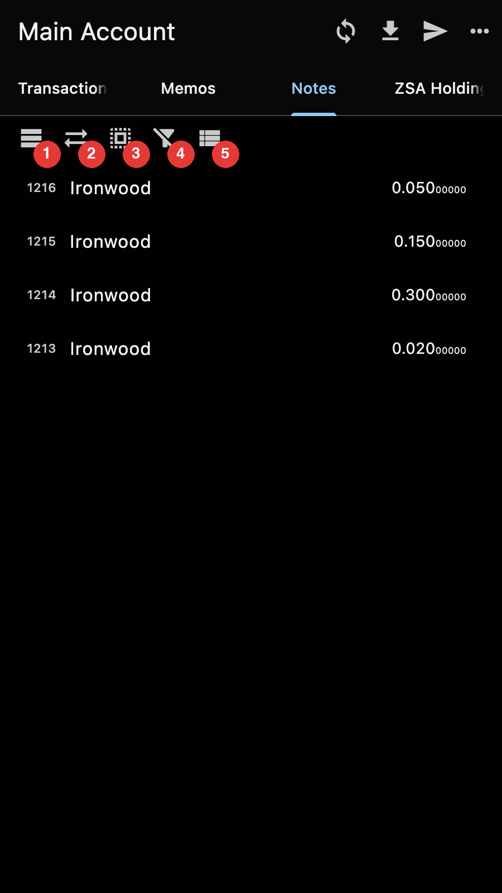

Specific *Notes* can be locked so that they are not used in transactions. For
example, you may want to lock the particular note because it has just been
received.

Another typical usage are mining rewards. Mining rewards cannot be spent before
they mature for at least 100 blocks. Attempting to do so will trigger an error.

Zkool lets you either manually lock specific notes by clicking on them on the
Notes tab[^1] or based on a maturity threshold, like 100.

The buttons are respectively for:
1. Locking the recently mined notes. Zkool asks for the number
of confirmations below which a note gets locked
2. Toggling every note
3. Unlocking everything
4. Showing or hiding the dust notes
5. Grouping the notes by pool. Each group then has its own lock/unlock all button

::: important
Notes in grey are locked.
:::

[^1]: It toggles between locked/unlocked.
