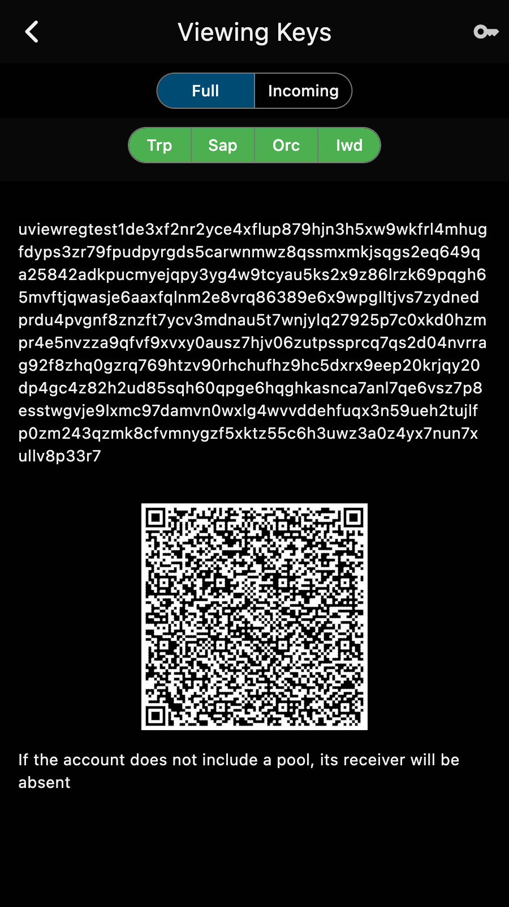
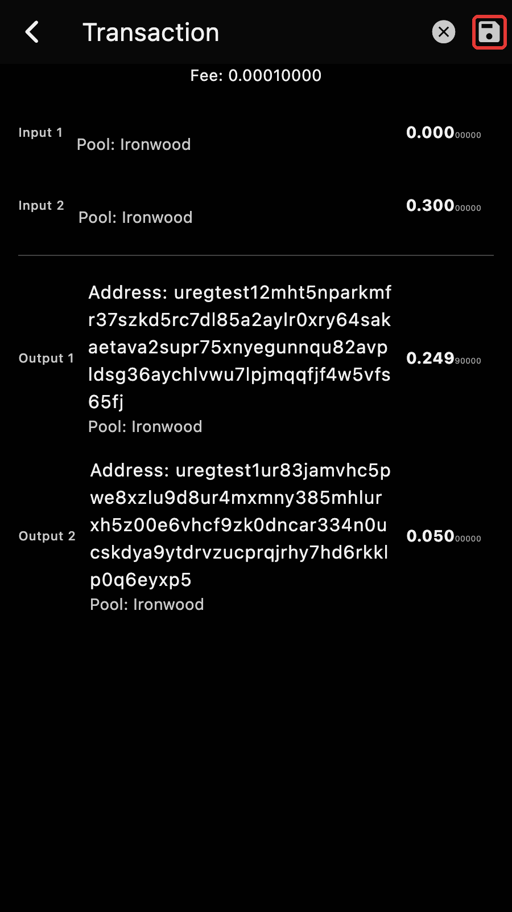
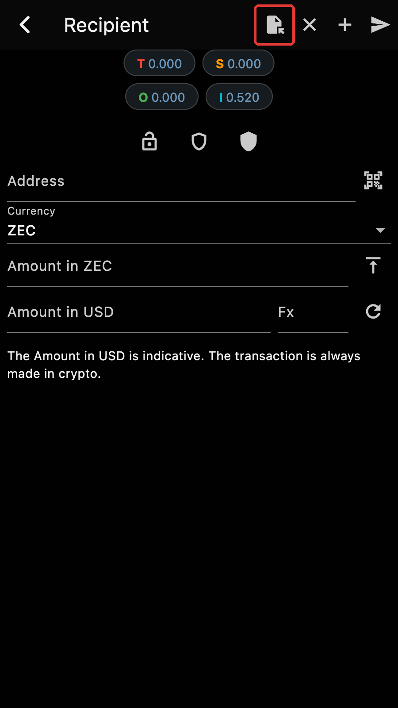
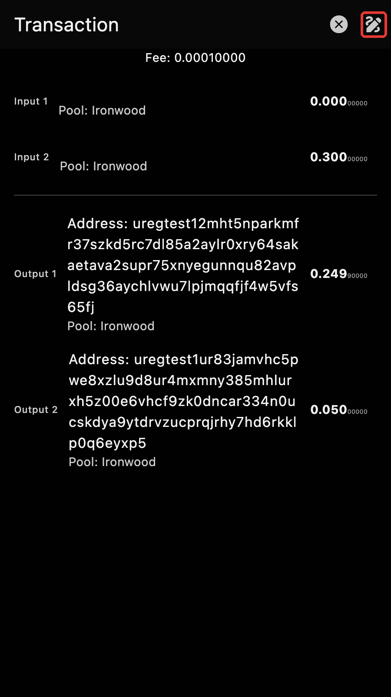
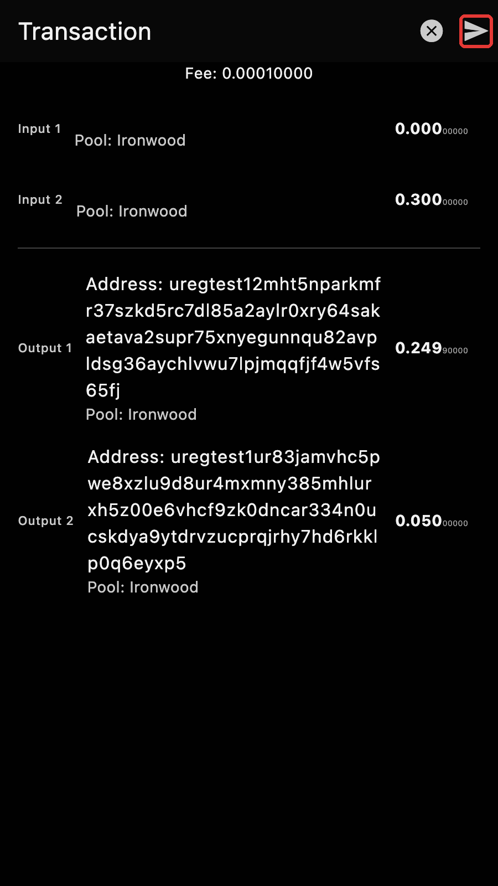

> A Cold Wallet is a wallet that has secret keys but remains disconnected from the Internet **at all times**.

It is not sufficient to be disconnected _most of the time_. For instance, a wallet on a phone that it is turned on only when making transactions is NOT a cold wallet.

To make a payment, there needs to be another wallet that connects to the Zcash network and synchronizes the blockchain data. This wallet has the account _viewing key_ to properly identify the wallet transactions but is not capable of spending any funds. We'll call it the "Hot Viewing Wallet"[^1].

You have two copies of Zkool: The "Hot Viewing Wallet" (HVW) and the "Cold
Wallet" (CW).

::: tip
To make sure the Cold Wallet does not connect to the Internet, you can turn off
WIFI and Mobile Data. Zkool has the "Offline" switch in the Settings page
as well.
:::

## Setup

1. Start on the CW. Create a new account. Backup the seed phrase to a safe place (do not put the seed phrase on your phone or in the Cloud).
2. Show the UFVK: on the account page, choose "Backup" in the menu. Keep "Full" selected.

::: tip
Scan the QR code on the HVW and restore a wallet using it as the Key.
:::
3. Synchronize it.

::: important
- Make sure you keep the cold wallet offline.
- Make sure you do not have a copy of the seed phrase on a device that can
connect to the Internet.
- The CW needs the Sapling parameters to sign. Download them from the
Settings page *before* you take it offline.
:::

## Payments

### Step 1: Make the **Unsigned** Transaction

Use the HVW to monitor incoming transactions and verify outgoing payments. To
start a payment from the account, use the HVW and enter the details of the
payment as usual.

Once you reach the final screen with the Transaction Plan, you probably will
notice that the "SEND" icon has been replaced by a "SAVE" icon. This indicates
that the account cannot sign the transaction and is view/watch-only.

Use this to make a PCZT (Partially Created Zcash Transaction) file.

::: tip
Use a *clean* USB drive to move the PCZT file. The file does not have secret
data but contains the details of the transaction. It is better not to put it
online if the transaction has to remain absolutely private.
If your devices have cameras, turn on "File Transmission via QR Codes"
in the Settings of both wallets. Zkool then shows the file as a series of
QR codes instead of saving it, and scans them instead of opening a file.
:::

### Step 2: Sign the Transaction

On the CW, open the send page of the account that has the secret key
and tap on the "Load an unsigned transaction" button.

The transaction plan appears, with a "SIGN" icon in place of the "SEND" icon.

::: important
Make sure you **CHECK** the transaction before signing.
:::

Tapping on it signs the transaction and saves the *signed* transaction
file. Transfer the file back to the HVW using the same
mechanism as before but in the reverse direction.

### Step 3: Broadcast the Signed Transaction

On the HVW, load the signed transaction from the send page of the account
that has the viewing key.

Press the Send button to send the transaction out.

::: tip
You should check one last time that the transaction is as you want. This is the
final step.
:::

[^1]: A hot wallet is a wallet connected to the Internet.
