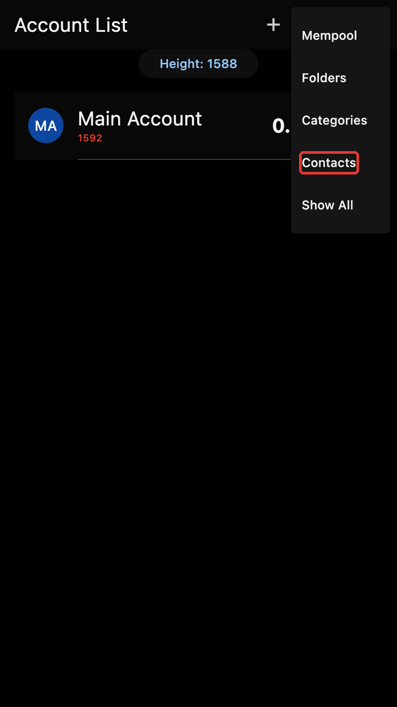
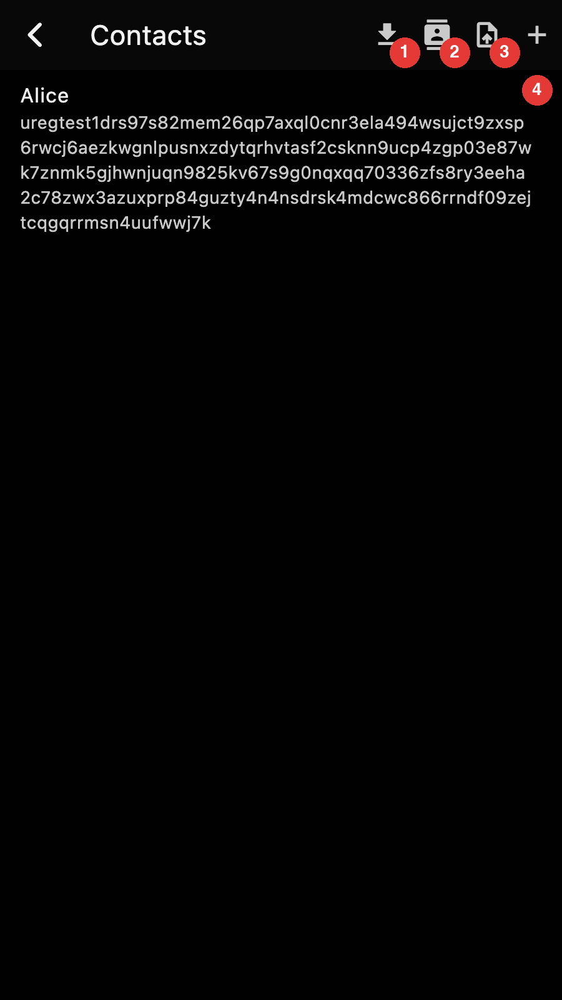
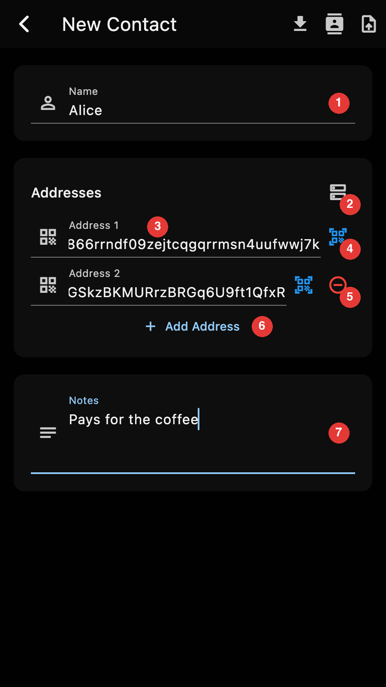
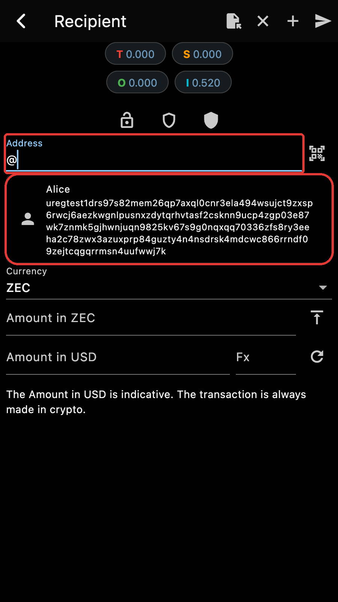

Contacts are Zkool's address book: a name, one or more Zcash addresses and
a note. They belong to the wallet database, not to an account, so every
account can pay a contact and sees its name in its history.

The "Contacts" option of the account manager menu opens the contact list.



## The contact list



1. Import contacts from a vCard file
2. Import contacts from the phone's address book
3. Export every contact as a vCard file
4. New contact

Each row shows the name and the first address of a contact. Tap on a row to
edit it.

## Adding or editing a contact



1. The name. It is required and must be unique.
2. Import the addresses published under an OpenAlias (see below)
3. An address. Zkool accepts unified, transparent and Sapling addresses and
   rejects anything else.
4. Scan the address from a QR code
5. Remove this address. The first address has no remove button.
6. Add another address
7. Free text notes

There is no save button. Leaving the page with the back arrow saves the
contact, and Zkool refuses to leave while the name is missing or an address
is invalid. Leaving a form you have not touched saves nothing.

When you edit an existing contact, the app bar has a trash icon that
deletes it after a confirmation.

::: tip
The editor's app bar has the same vCard and phone import buttons as the
list, but they fill the form with one contact instead of saving a batch.
:::

## Paying a contact



On the Send page, type `@` in the address field. Zkool lists your contacts
under the field, and typing more letters narrows the list by name. Tap on a
contact to put its first address in the field.

You can also type the full `@name` and leave it. Zkool resolves it to the
contact's first address when you send, and reports an unknown contact
instead of sending.

## Contacts in the history

A transaction to or from one of a contact's addresses shows the contact
name in its row of the transaction history and in the transaction details,
and the search box of the history filters by contact name.

A [unified address](../guide/addresses.md) bundles several receivers, one
per pool: transparent, Sapling and Orchard. A transaction output always
goes to exactly one receiver. When you pay someone, your wallet picks one
receiver out of their bundle, and when someone pays you, their wallet does
the same, so what a transaction records is a single receiver, never the
full unified address you saved. Zkool takes this into account: a contact
saved with a unified address is recognised when a transaction uses any one
of its receivers, and a contact saved with a bare transparent or Sapling
address is recognised when that receiver appears inside a unified address.
The match is on the receiver and its pool, not on the text of the address.

## vCard import and export

"Export as vCard" on the contact list writes every contact to a
`contacts.vcf` file. The file is a standard vCard 4.0 and opens in any
address book. The Zcash addresses go in the note of the card, as `zcash:`
URIs under a label, so that other apps show them as plain text:

```
BEGIN:VCARD
VERSION:4.0
FN:Alice
NOTE:Pays for the coffee\n\nZcash addresses:\nzcash:u1...\nzcash:t1...
END:VCARD
```

"Import from vCard" reads such a file back. For each card, Zkool scans the
note line by line: a `zcash:` URI or a bare Zcash address becomes an
address of the contact, and every other line stays in the notes. Cards
that carry their addresses in `X-ZCASH-ADDRESS` properties, as older
versions of Zkool wrote them, are read too. A card without a single valid
Zcash address is ignored.

When a card has the same name as an existing contact, Zkool updates that
contact: the addresses of the card are added to the ones it already has,
without duplicates.

To move a contact from one address book to another, write the
address on its own line in the contact's notes, with or without the
`zcash:` prefix, and export it as a vCard.

## Import from the phone's contacts

On Android and iOS, "Import from Contacts" asks for access to the phone's
address book and shows a picker. Zkool looks for Zcash addresses in the
notes, the websites and the social media fields of each contact, and lists
the contacts that have at least one. Pick the ones you want and Zkool
creates them with the name, the addresses and the notes it found.

::: tip
Two reasons a contact does not show up or does not import:

- iOS does not let apps read the notes of a contact, so on an iPhone the
  address has to be in a website or social media field.
- A contact whose name already exists in Zkool is skipped.
:::

## OpenAlias

[OpenAlias](https://openalias.org) publishes a payment address under a
name that looks like an email address, as a DNS text record. For example,
the alias `hanh@methyl.cc` is the record of `hanh.methyl.cc`:

```
oa1:zcash recipient_address=u14w0sxek2wnrwmtz0cg8nec2wwm39vs3r2k5x69pc2fla3ucv5ejgptfsdh2egjpfp9q2l2mfpy03ta2gueqh4t729qsu57cjzcvrwm0l;
```

Zkool resolves OpenAlias names in two places:

- On the Send page, type the alias with a `#` prefix, as in
  `#hanh@methyl.cc`. Zkool looks it up when you send and pays the
  address it finds. If the record has a `tx_description`, it becomes the
  memo.
- In the contact editor, "Import from OpenAlias" asks for the alias and
  adds the addresses it finds to the contact. Keep the contact and you no
  longer depend on DNS for later payments.

DNS answers can be forged, so Zkool checks the DNSSEC signature of the
record and reacts to what it finds:

| Status | Meaning | What Zkool does |
| --- | --- | --- |
| verified | The domain is signed and the answer checks out | Uses the address |
| unsigned | The domain has no DNSSEC, the answer cannot be verified | Shows "DNSSEC not available" and asks whether to proceed |
| bogus | The domain is signed but the answer failed validation | Shows "DNSSEC validation failed", warns that the answer may have been tampered with, and asks whether to proceed |

Decline the bogus case: someone may be redirecting the payment. The unsigned
case is common, most domains are not signed. At the time of writing,
`methyl.cc` is one of them, so the example above shows the "DNSSEC not
available" dialog.
