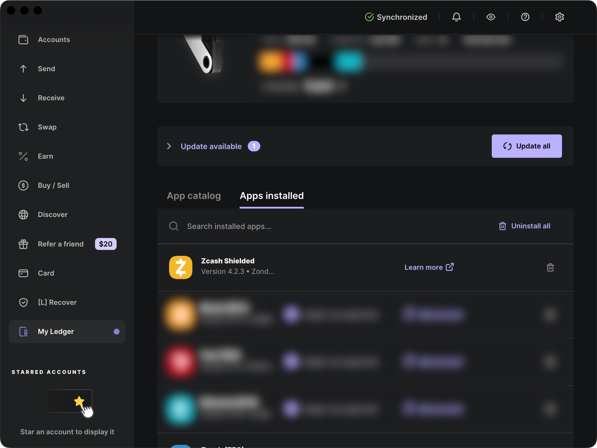
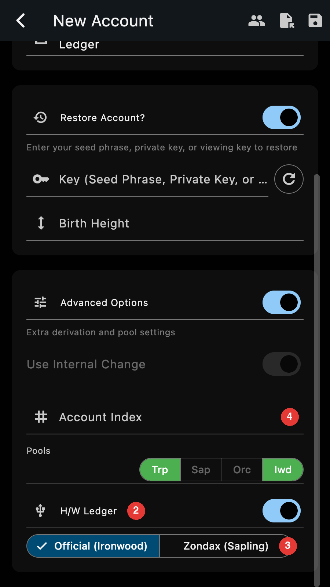
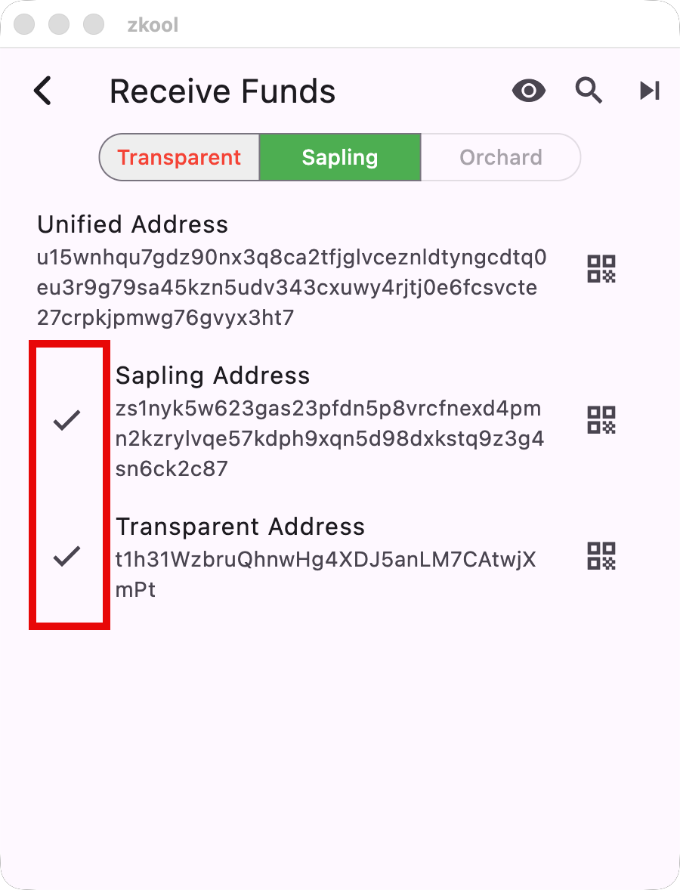

Zkool works with two Ledger apps for Zcash:

- the **official** Zcash app by Ledger. It supports the transparent
and the Orchard / Ironwood pools, and follows the regular derivation
of the seed phrase,
- the **Zcash Shielded** app by Zondax. It supports the transparent
and the Sapling pools, with a custom derivation.

Prefer the official app. The Zondax app is older and only has Sapling.

::: warning
The Zondax app has been broken by network upgrades in the past.
**Do not keep shielded funds on it unless you have checked that
the current version can sign.**
:::

If you have funds locked in a Zondax account, you cannot use its
seed phrase in another wallet because of its custom derivation.
However, Zkool restores a Zondax seed phrase *when you toggle the H/W
Ledger switch and choose the Zondax app*.

## Requirements

Zkool is compatible with the Ledger NanoS+, NanoX, Stax, Flex and later.
It is _not_ compatible with the Ledger NanoS.

Install the app using Ledger Live.

::: important
The Ledger apps can be finnicky. They sometimes stop responding to commands from the
host app without notice. I have the best experience when **I connect the
device, unlock it and launch the Zcash app before starting Zkool**.
:::

## For Linux Users

If you have permission errors:

From the [Ledger website](https://support.ledger.com/article/115005165269-zd)

- Open the terminal on your computer.
- Run: `wget -q -O - https://raw.githubusercontent.com/LedgerHQ/udev-rules/master/add_udev_rules.sh | sudo bash`
- Try again to access My Ledger or perform the Genuine check.

## Importing a Ledger account

Create a new account as usual, switch on "Advanced Options" and then:

1. enter the account name,
1. **turn on the "H/W Ledger" switch**,
1. choose the app: "Official (Ironwood)" or "Zondax (Sapling)",
1. enter the account index. 0 for the default account,
1. enter the **birth height**: the block height at which the account was
   created[^1].

Leave the key field blank: the viewing key is imported from the device.
Save the new account.

:::warning
Make sure the Ledger is **connected** and **unlocked**. The Zcash
app MUST be running. Ledger Live or other apps that use the Ledger MUST NOT be running.
:::

> Importing a Ledger account takes around 1 minute. At some point, you will be
> requested to review some addresses/keys on the device and approve.

If the import fails or takes too long, disconnect/reconnect the device and
restart Zkool.

:::tip
When the Ledger performs a task, its UI freezes and the buttons
are unresponsive. If you are waiting and expecting the Ledger
to be working, click on the buttons to check that it is indeed processing.
:::

::: note
The internal change setting is decided by the app: the official app
always uses an internal address for the change, the Zondax app never does.
:::

## Scan Transparent Addresses

If you have received funds in this account, be sure to scan for alternative
addresses because the Ledger Live app rotates addresses. Zkool offers
the scan when the account is created.

## Sync

Sync to get the transaction history and balance.

## Receive/Send

To receive funds, you just need the address. You don't need the device itself.

::: important
Verify that the address you use to receive matches the one that your ledger
has. Otherwise you could be sending funds to a hacker's address.
:::

Press the check buttons to make the Ledger show its address and **verify** that
it matches the address in the wallet.

Sending is not different from sending from a regular account.
The device asks you to confirm the transaction.
However, the Zondax app limits a transaction to 5 inputs and 5 outputs of each type
(transparent/sapling).

If your transaction is too complex, you may want to consider using Coin Control
(i.e. locking notes) to limit the number of inputs.

> *Signing a Ledger transaction may take several minutes.*

## New Diversified Addresses

With the official app, pressing the new diversified address button
works as for a regular account.

With the Zondax app, it gives you a new set
of transparent + sapling addresses. However, the diversifier index associated
with these addresses does not follow ZIP 316[^2].

For transparent addresses, the address index gets incremented by 1.
For sapling addresses, the diversifier index is chosen pseudo-randomly.

## ZIP-32

The Zondax app does not derive the sapling account according to ZIP 32 because
ZIP 32 requires access to the seed phrase that is protected by the OS[^3].

[^1]: an earlier block works too.
[^2]: due to a bug in the Zondax app.
[^3]: for security reasons, apps do not have direct access to the seed phrase.
They register for a given derivation path and only get the secret key at that
level.
