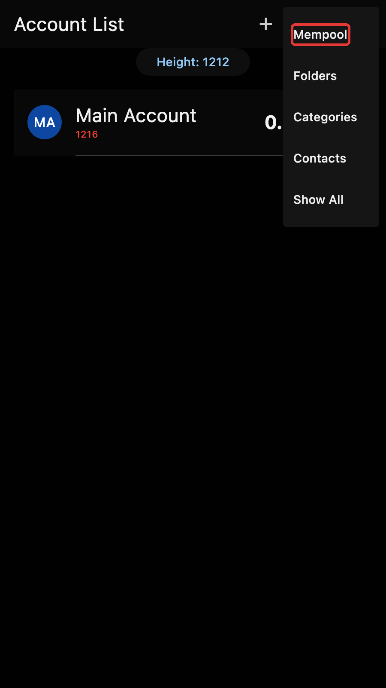
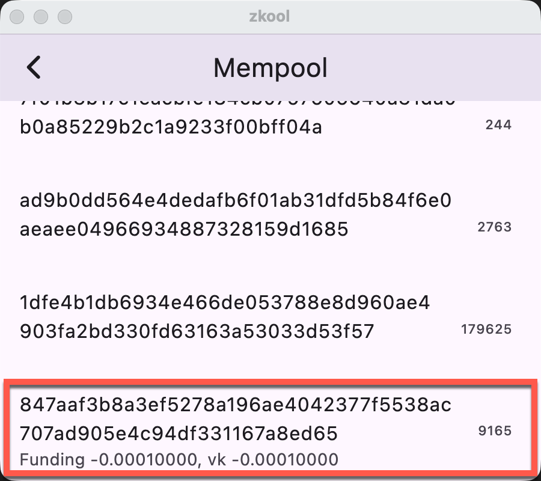

Zkool integrates a simple Mempool transaction viewer. Open it with
the "Mempool" option of the account manager menu.

Each row shows the transaction id, the change of balance of your
accounts involved in the transaction, and its size in bytes.

The account page shows the unconfirmed balance change (if there is any)
under the balance.
