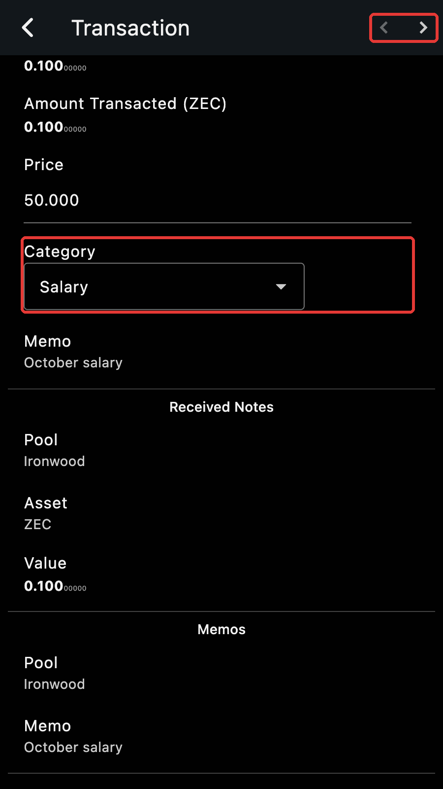
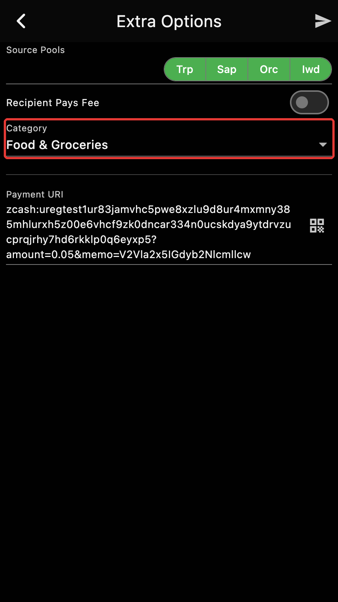
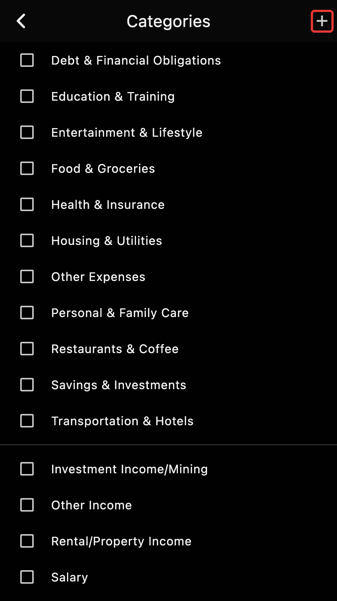
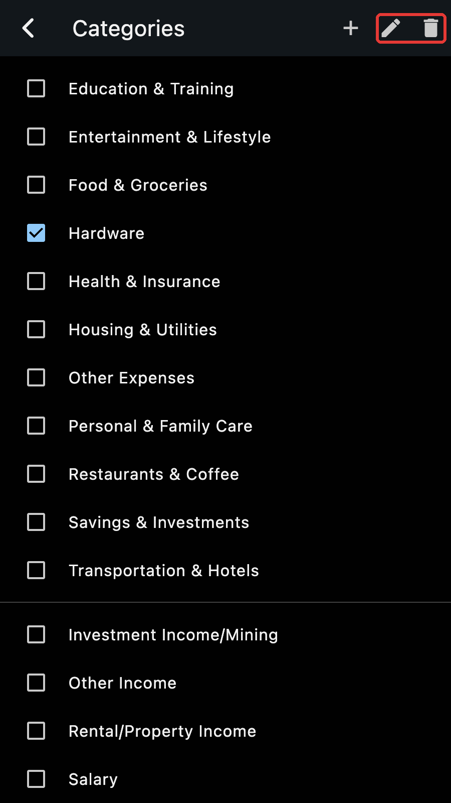

# Assigning a Category

## Old Transactions
For transactions that have been mined and are part of your account history,
open the transaction page from the history and pick the category in the
dropdown list. "Unknown" leaves the transaction out of the reports.

::: tip
Navigate through your transaction history quickly using the arrows.
:::

## New Payments
When you make a payment, you can assign a category too. It is on the
"Extra Options" page of the send flow.

# Managing Categories

Zkool comes with a list of predefined categories, but you can make your own list.

Open the category editor from the account manager menu.

The List of Categories shows up. Expense categories come first, then the
income categories. Like the Folder Manager, add new categories with the "+"
button on the app bar.

A category has a name and an "Income?" checkbox. Unchecked, it is an
expense.

Edit and Delete categories by first selecting them and using the associated
button on the app bar.

> Deleting a category does not delete its transactions. They become
> unassigned and leave the reports until you give them another category.
