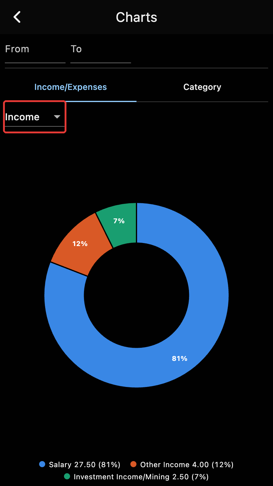
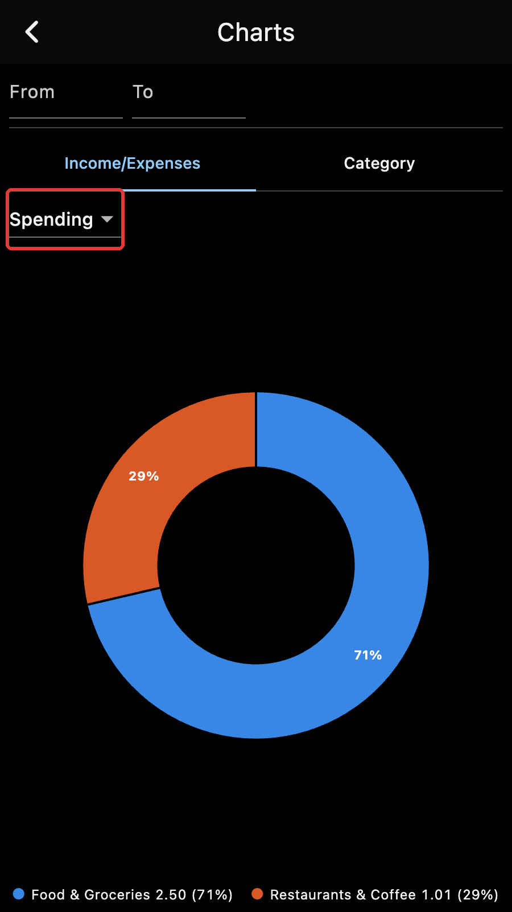
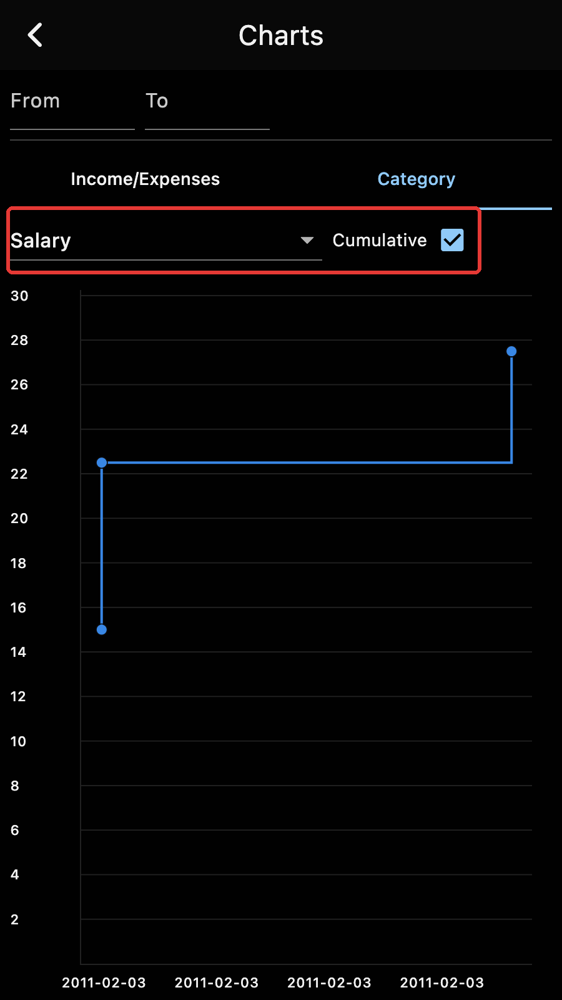

## Income grouped by categories

The salary, a bonus, a mining payout and a gift, each received in ZEC and
filed under an income category.

## Spending grouped by categories

Two payments, filed under "Food & Groceries" and "Restaurants & Coffee".

## Salary over time

The cumulative total of the "Salary" category, one step per payment received.

