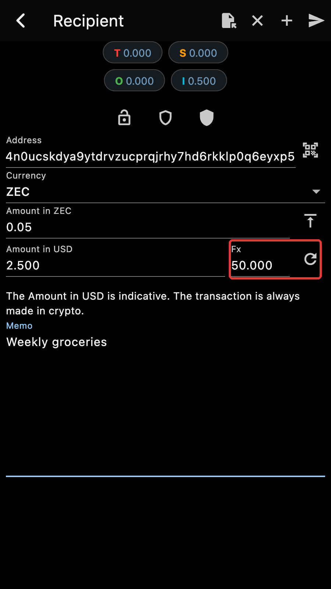
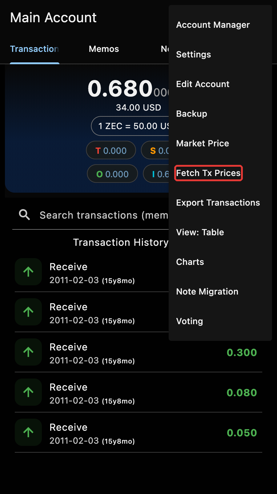
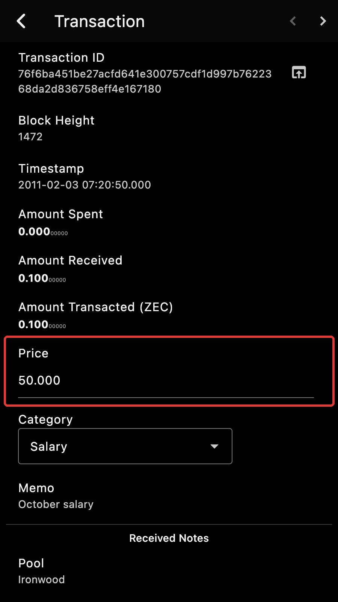

The expense and income reports use a fiat currency because at this time
nearly all of the services use fiat. To convert between ZEC and your
currency, each transaction must have the price of 1 ZEC.

## Currency

The currency is USD by default. Change it with the "Currency" option of the
Settings page. Since the prices of your past transactions are in the old
currency, Zkool asks for the exchange rate between the two currencies
(prefilled from CoinGecko when it is reachable) and converts them.

## New Payments

When you make a payment, the "Fx" field of the Send form holds the last
market price Zkool fetched: tap the "Height" button of the account manager,
which fetches the market price too, or turn on "Auto Fetch Market Price" in
the Settings page. You can
also type the price or fetch it again from CoinGecko with the refresh button
next to the field. It gets recorded with the transaction in your account[^1].

## Past Transactions

Zkool can also automatically import historical prices from CoinGecko, with
the "Fetch Tx Prices" option of the account page menu.

It fills in every transaction of the account that has no price yet. The public
API only provides the past year of data. CoinGecko returns market prices at
different time intervals depending on the time range:
- Current Day: Every minute,
- From 2 to 90 days: Every hour,
- From 90 to 365 days: Every day.

If a transaction falls out of this range, it will get the oldest known market
price.

::: tip
You can adjust the market price of a transaction by editing the price in the
transaction details page. A transaction without a price shows "N/A": fetch
the prices first.
:::

Zkool uses the public CoinGecko API. If you have a CoinGecko API key, enter
it in the "CoinGecko API Key" field of the Settings page.

[^1]: ZEC prices and categories are not recorded on chain, therefore if you
    restore your wallet on a different device you will have to input the data
    again. It is much more convenient to save and restore the account with the
    Import/Export feature.
