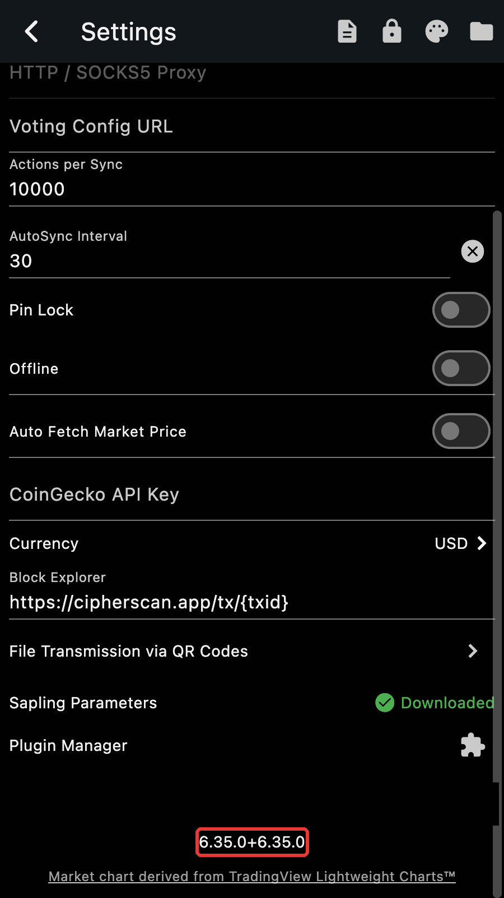
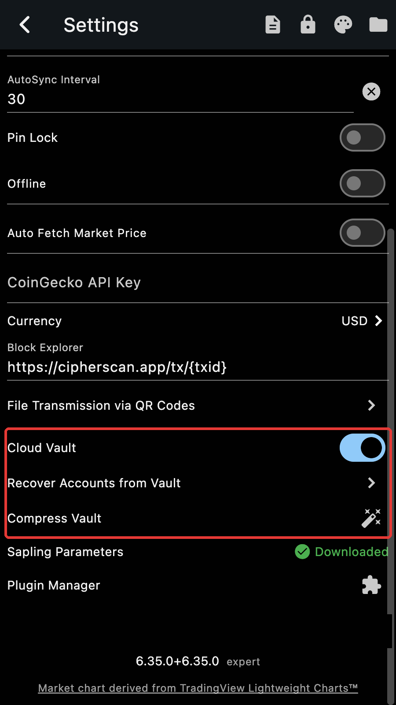

## Expert mode

The Cloud Vault rows of the Settings page only show in **expert mode**.
Open Settings, scroll to the bottom and **long press the version number**.
The word *expert* appears next to it and three rows appear above: the
"Cloud Vault" switch, "Recover Accounts from Vault" and "Compress Vault".
The last two only show while the vault is on. Long press the version again
to leave expert mode.

::: tip
Expert mode also shows the detailed synchronization logs. It is remembered
between restarts.
:::

## Enable the vault

Turn on the "Cloud Vault" switch. Zkool asks you to unlock the app, then
shows what the vault does before you confirm. Then:

1. Pick the Google account that will hold the vault. The picker is shown
   every time the vault is enabled, so you can choose another account.
1. If this Google account has no vault yet, create the **vault password**.
   This is the master password: write it down, there is no way to reset it.
1. On a device with passkeys, register one for the vault. If this account
   already has a vault, pick an existing passkey or register a new one; a new
   device asks for the master password once to let its passkey in.

The switch stays on and "Vault activated" is shown. From now on, every new
account and every account edit is written to the vault. The accounts that
already existed when you turned the vault on are not uploaded by themselves:
open each one with Edit Account and save it once.

## Recover accounts

On a new device, turn on expert mode, turn on the "Cloud Vault" switch and
sign in to the same Google account, then tap **Recover Accounts from Vault**.

1. With passkeys, Zkool shows the passkey picker first. Cancel it to use the
   master password instead.
1. Without a passkey, enter the **vault password**.
1. Zkool downloads and decrypts the vault and lists the accounts it holds,
   with a search field and Select All. Pick the ones to restore.

An account that already exists in the wallet, with the same seed and account
index, is updated with the name and birth height from the vault; the others
are created. Synchronize them afterwards.

::: important
Recovery restores the keys, not the synchronization data. A restored account
scans the chain from its birth height, like any restored account.
:::

## Compress the vault

The vault only grows: every edit adds an entry. **Compress Vault** reads the
vault back, keeps the latest entry of each account, and writes a fresh vault
with just those, under a new master password and, if you wish, on a
different Google account. It refuses to run while the wallet has accounts,
so use it on an empty wallet, or on a fresh install before recovering.

1. Enter the current vault password.
1. Check the list of accounts the vault holds.
1. Choose the new vault password.
1. Say whether the new vault goes to a different Google account.

Compressing is also how you change the master password.

## Turn the vault off

Turning the "Cloud Vault" switch off signs out of Google on this device and
stops writing to the vault. The vault itself stays in the Google account,
and turning the switch on again, with the same account, picks it up where it
was.
