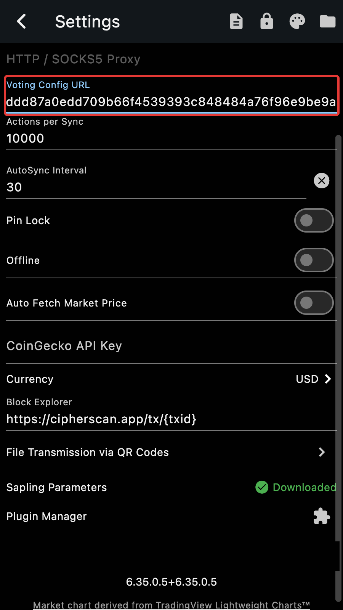
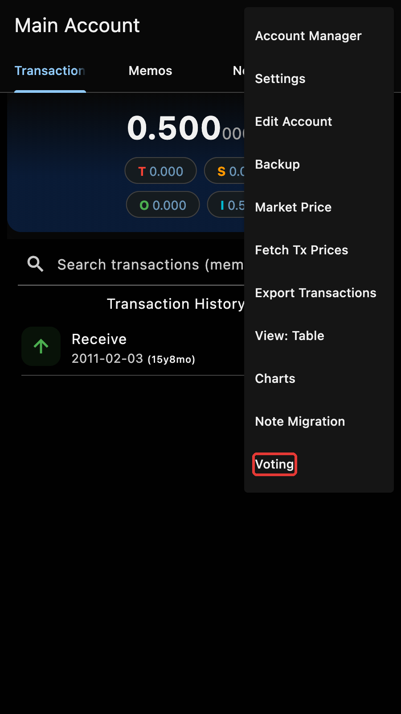
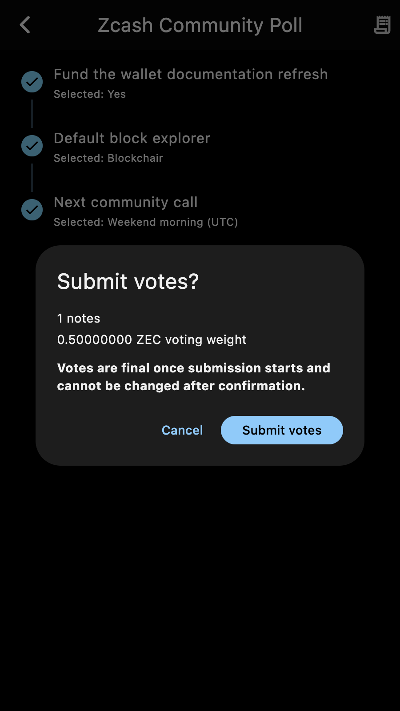
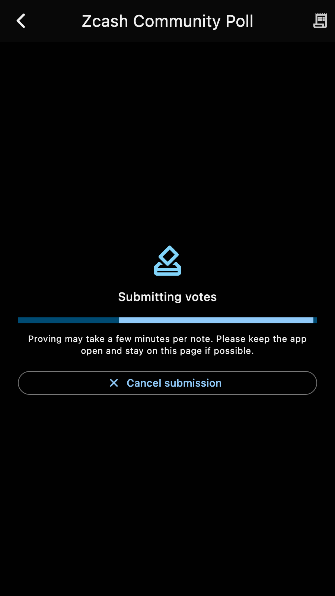
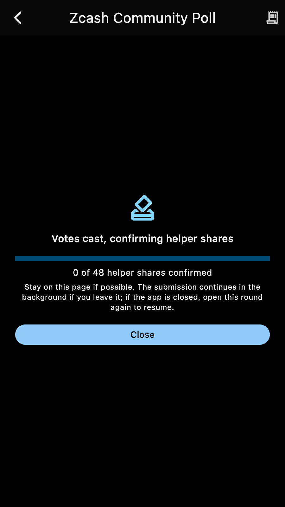
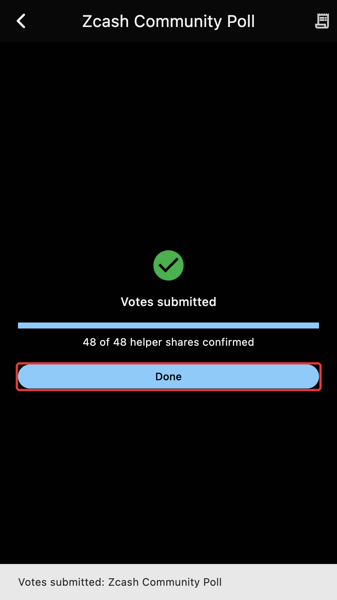
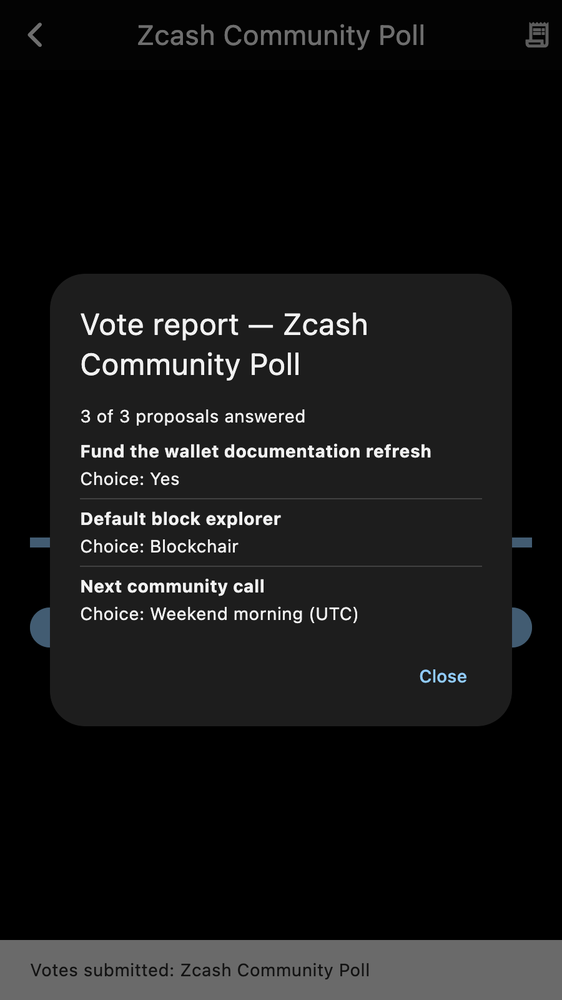
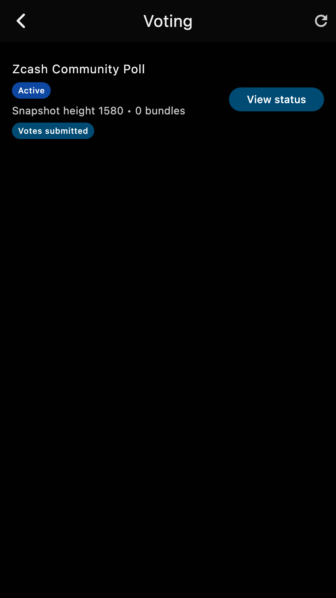

See the [Overview](./overview.md) for what a coin weighted poll is and what
you need before you vote.

## Summary
- Enter the organizer's voting config URL in the Settings
- Open "Voting" from the account page menu and pick the round
- Fill the ballot, one proposal at a time
- Submit, and stay on the page while the votes are cast and confirmed

## Voting Config

The organizer of the poll gives you a **voting config URL**. It points to
a signed configuration that lists the rounds, the voting servers and the
keys that sign them. Enter it in the "Voting Config URL" field of the
Settings page.

::: tip
The URL carries a checksum of the configuration. A new configuration means
a new URL: enter the one the organizer sends you for the round.
:::

## Rounds

Open the "Voting" option of the account page menu.

Zkool fetches and verifies the configuration, then lists the rounds with
their status, their snapshot height and their number of bundles. Tap on an
"Active" round, or on its "Start voting" button.

A round you already voted in says so, and its button becomes "Review".

## Ballot

The ballot shows the proposals one at a time. Pick an option, then tap
"Next". "Skip" leaves a proposal unanswered; it is not the same as choosing
an abstention option when the proposal has one. "Clear selection" undoes a
choice, and "Back" returns to the previous proposal.

Your choices are saved as you go: you can close the ballot and come back to
it later. The last proposal has the "Submit" button.

## Submission

Zkool first checks which of your notes are eligible and shows the result:
the number of notes, the voting weight in ZEC, and, when the round has one,
whether you meet its minimum voting rule. Some rounds withhold a few small
notes for privacy; the preview says how much.

::: important
Votes are final once the submission starts. There is no way to change them
after confirmation.
:::

Tap "Submit votes". The page reads "Submitting votes" while Zkool proves
your notes and sends the ballot to the voting servers.

::: important
Proving may take a few minutes per note. Please keep the app open and stay
on this page if possible. If you leave the page, the submission continues in
the background. If you close the app, open the round again: the submission
resumes by itself where it left off.
:::

Once the votes are cast, the page reads "Votes cast, confirming helper
shares": a part of each vote goes to *helper servers*, which reveal them
when the round ends. The page counts the shares as the helpers confirm them.
This takes a few seconds per share.

The page ends with "Votes submitted" once every share is confirmed, and a
message says so wherever you are in the app.

Other states the page can show:

- **Submission cancelled**: you cancelled the submission. Tap "Resume
  submission".
- **Submission interrupted**: the submission stopped and did not resume by
  itself, for example because the app is offline. Tap "Resume submission".
- **The round closed with N helper shares unconfirmed**: the round ended
  before every share was confirmed. A share that was not confirmed cannot be
  revealed, so the vote it belongs to may not count.
- **N helper shares could not be delivered**: the helper servers refused
  these shares, and trying again cannot help.
- **Ballot incomplete**: a proposal has no answer. Go back to the ballot.
- **Delegation signatures needed**: the round delegates votes, and a
  signature is missing. Follow the round's instructions.
- **Bundle setup needed, prepare again**: the preview is stale. Submit
  again.
- **Chain rejected the submission**: the voting servers refused the ballot,
  for example because the notes already voted. The reason is shown on the
  page.
- **Submission recovery stalled, try again later**: the servers could not be
  reached for a while. Tap "Resume submission" later.

## Receipt

The "Vote report" button on the app bar lists the choice you made on every
proposal of the round.

Back on the rounds page, the round shows "Votes submitted".

> Thanks for voting!

::: important
A note can vote only once in a round. If you hold voting funds in several
accounts, vote from each account in turn.
:::
